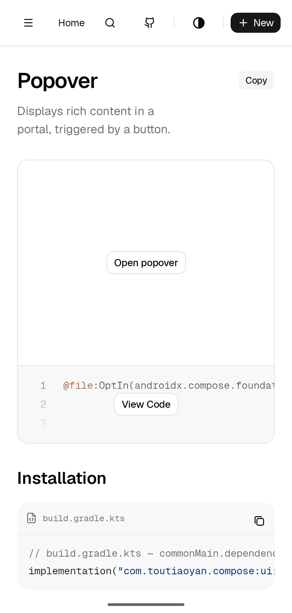
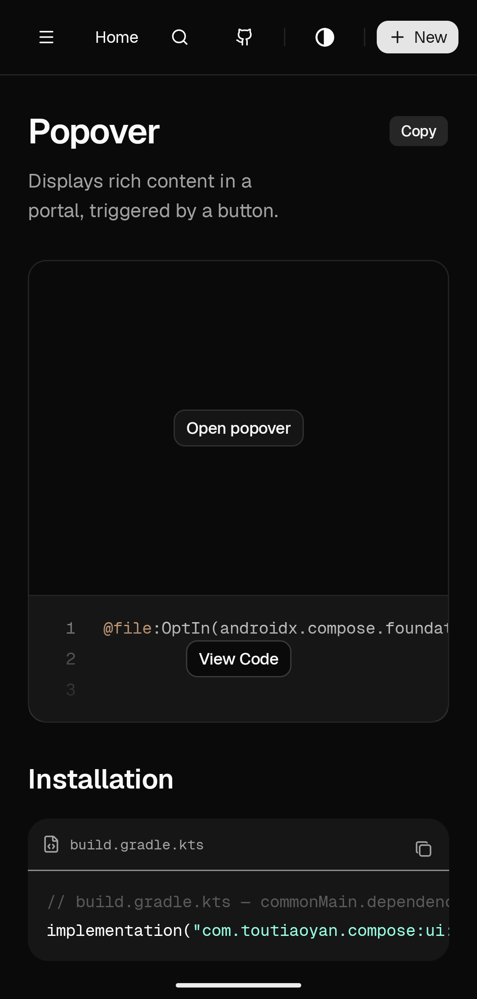

# Popover

对照状态为初始态。 [shadcn 示例和采集记录](https://github.com/csdog/shadcn-baselines/blob/3369d6e3dfaee687b5e4a130fa3a05a6dd1ee1ce/popover/Index.md)

| 序号 | 主题 | Compose Multiplatform Android | shadcn 视觉基准 |
| ---: | --- | --- | --- |
| 1 | 浅色 |  |  |
| 2 | 深色 |  |  |
