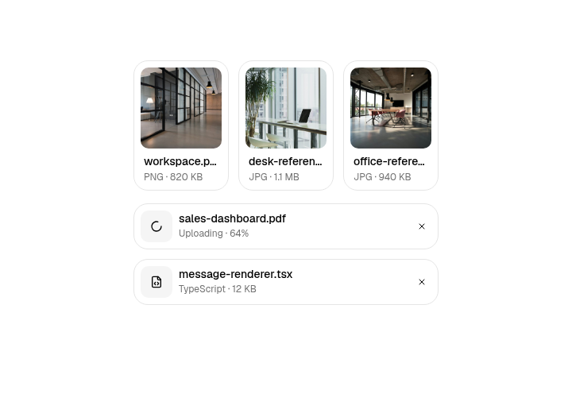
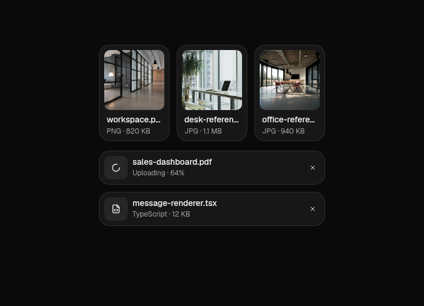

# Attachment

上游示例样式为 `base-rhea`。 [官方示例](https://ui.shadcn.com/examples/base/attachment-demo) · [示例源码](https://github.com/shadcn-ui/ui/blob/0e5b2e621a9ee4cf6a604bbe6c5c0d5b70561eb4/apps/v4/examples/base/attachment-demo.tsx) · [采集记录](./provenance.json)

| 状态 | 主题 | 截图 |
| --- | --- | --- |
| 初始态 | 浅色 |  |
| 初始态 | 深色 |  |

## 变体和交互状态

[采集记录](coverage.json)

| 官方示例 | 变体 | 截图状态 | 示例样式 | 参考截图 |
| --- | --- | --- | --- | --- |
| [attachment-group](https://ui.shadcn.com/examples/base/attachment-group) | `group` | `initial` | `base-rhea` | [浅色](attachment-group-initial-light.png) · [深色](attachment-group-initial-dark.png) |
| [attachment-image](https://ui.shadcn.com/examples/base/attachment-image) | `image` | `initial` | `base-rhea` | [浅色](attachment-image-initial-light.png) · [深色](attachment-image-initial-dark.png) |
| [attachment-sizes](https://ui.shadcn.com/examples/base/attachment-sizes) | `sizes` | `initial` | `base-rhea` | [浅色](attachment-sizes-initial-light.png) · [深色](attachment-sizes-initial-dark.png) |
| [attachment-states](https://ui.shadcn.com/examples/base/attachment-states) | `states` | `initial` | `base-rhea` | [浅色](attachment-states-initial-light.png) · [深色](attachment-states-initial-dark.png) |
| [attachment-trigger](https://ui.shadcn.com/examples/base/attachment-trigger) | `trigger` | `initial` | `base-rhea` | [浅色](attachment-trigger-initial-light.png) · [深色](attachment-trigger-initial-dark.png) |
