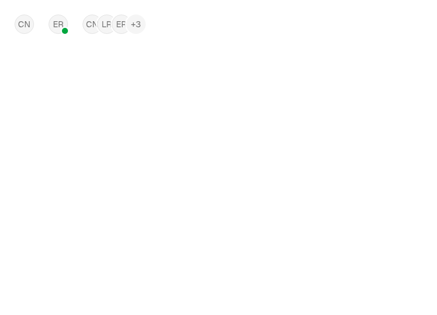
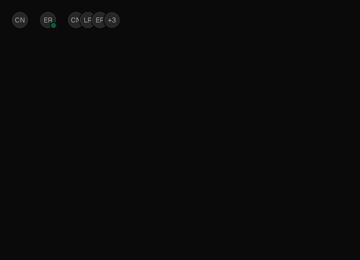

# Avatar

上游示例样式为 `base-nova`。 [官方示例](https://ui.shadcn.com/examples/base/avatar-demo) · [示例源码](https://github.com/shadcn-ui/ui/blob/0e5b2e621a9ee4cf6a604bbe6c5c0d5b70561eb4/apps/v4/examples/base/avatar-demo.tsx) · [采集记录](./provenance.json)

| 序号 | 状态 | 主题 | 截图 |
| ---: | --- | --- | --- |
| 1 | 初始态 | 浅色 |  |
| 2 | 初始态 | 深色 |  |

## 变体和交互状态

[采集记录](coverage.json)

| 序号 | 官方示例 | 变体 | 截图状态 | 示例样式 | 参考截图 |
| ---: | --- | --- | --- | --- | --- |
| 1 | [avatar-badge](https://ui.shadcn.com/examples/base/avatar-badge) | `badge` | `initial` | `base-nova` | [浅色](avatar-badge-initial-light.png) · [深色](avatar-badge-initial-dark.png) |
| 2 | [avatar-badge-icon](https://ui.shadcn.com/examples/base/avatar-badge-icon) | `badge-icon` | `initial` | `base-nova` | [浅色](avatar-badge-icon-initial-light.png) · [深色](avatar-badge-icon-initial-dark.png) |
| 3 | [avatar-basic](https://ui.shadcn.com/examples/base/avatar-basic) | `basic` | `initial` | `base-nova` | [浅色](avatar-basic-initial-light.png) · [深色](avatar-basic-initial-dark.png) |
| 4 | [avatar-dropdown](https://ui.shadcn.com/examples/base/avatar-dropdown) | `dropdown` | `initial` | `base-nova` | [浅色](avatar-dropdown-initial-light.png) · [深色](avatar-dropdown-initial-dark.png) |
| 5 | [avatar-group](https://ui.shadcn.com/examples/base/avatar-group) | `group` | `initial` | `base-nova` | [浅色](avatar-group-initial-light.png) · [深色](avatar-group-initial-dark.png) |
| 6 | [avatar-group-count](https://ui.shadcn.com/examples/base/avatar-group-count) | `group-count` | `initial` | `base-nova` | [浅色](avatar-group-count-initial-light.png) · [深色](avatar-group-count-initial-dark.png) |
| 7 | [avatar-group-count-icon](https://ui.shadcn.com/examples/base/avatar-group-count-icon) | `group-count-icon` | `initial` | `base-nova` | [浅色](avatar-group-count-icon-initial-light.png) · [深色](avatar-group-count-icon-initial-dark.png) |
| 8 | [avatar-rtl](https://ui.shadcn.com/examples/base/avatar-rtl) | `rtl` | `initial` | `example-defined` | [浅色](avatar-rtl-initial-light.png) · [深色](avatar-rtl-initial-dark.png) |
| 9 | [avatar-size](https://ui.shadcn.com/examples/base/avatar-size) | `size` | `initial` | `base-nova` | [浅色](avatar-size-initial-light.png) · [深色](avatar-size-initial-dark.png) |
| 10 | [avatar-dropdown](https://ui.shadcn.com/examples/base/avatar-dropdown) | `dropdown` | `keyboard-focused` | `base-nova` | [浅色](avatar-dropdown-keyboard-focused-light.png) · [深色](avatar-dropdown-keyboard-focused-dark.png) |
