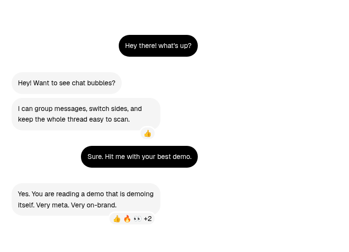
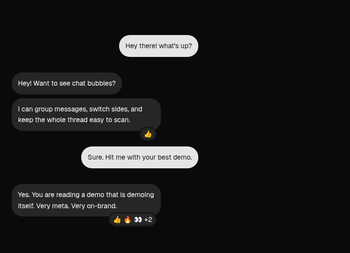

# Bubble

上游示例样式为 `base-rhea`。 [官方示例](https://ui.shadcn.com/examples/base/bubble-demo) · [示例源码](https://github.com/shadcn-ui/ui/blob/0e5b2e621a9ee4cf6a604bbe6c5c0d5b70561eb4/apps/v4/examples/base/bubble-demo.tsx) · [采集记录](./provenance.json)

| 状态 | 主题 | 截图 |
| --- | --- | --- |
| 初始态 | 浅色 |  |
| 初始态 | 深色 |  |
