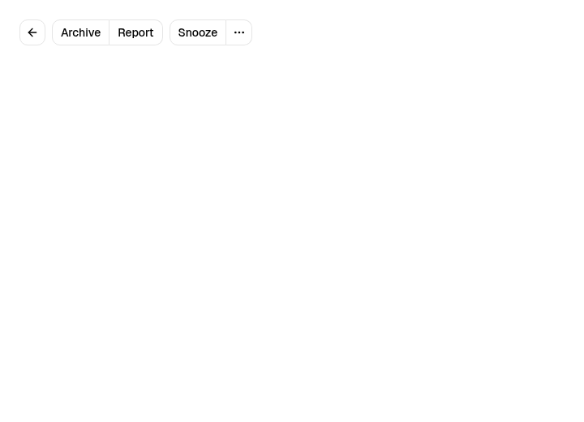
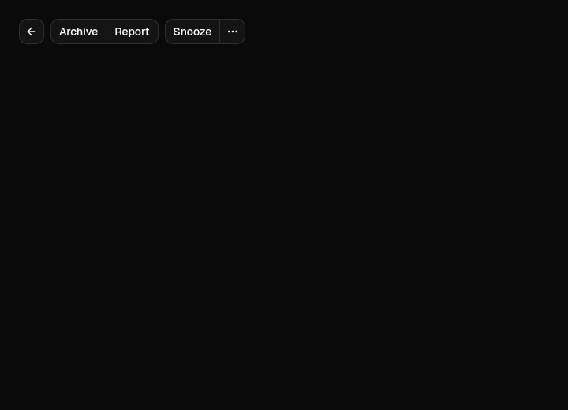

# Button Group

上游示例样式为 `base-nova`。 [官方示例](https://ui.shadcn.com/examples/base/button-group-demo) · [示例源码](https://github.com/shadcn-ui/ui/blob/0e5b2e621a9ee4cf6a604bbe6c5c0d5b70561eb4/apps/v4/examples/base/button-group-demo.tsx) · [采集记录](./provenance.json)

| 序号 | 状态 | 主题 | 截图 |
| ---: | --- | --- | --- |
| 1 | 初始态 | 浅色 |  |
| 2 | 初始态 | 深色 |  |

## 变体和交互状态

[采集记录](coverage.json)

| 序号 | 官方示例 | 变体 | 截图状态 | 示例样式 | 参考截图 |
| ---: | --- | --- | --- | --- | --- |
| 1 | [button-group-dropdown](https://ui.shadcn.com/examples/base/button-group-dropdown) | `dropdown` | `initial` | `base-nova` | [浅色](button-group-dropdown-initial-light.png) · [深色](button-group-dropdown-initial-dark.png) |
| 2 | [button-group-input](https://ui.shadcn.com/examples/base/button-group-input) | `input` | `initial` | `base-nova` | [浅色](button-group-input-initial-light.png) · [深色](button-group-input-initial-dark.png) |
| 3 | [button-group-input-group](https://ui.shadcn.com/examples/base/button-group-input-group) | `input-group` | `initial` | `base-nova` | [浅色](button-group-input-group-initial-light.png) · [深色](button-group-input-group-initial-dark.png) |
| 4 | [button-group-nested](https://ui.shadcn.com/examples/base/button-group-nested) | `nested` | `initial` | `base-nova` | [浅色](button-group-nested-initial-light.png) · [深色](button-group-nested-initial-dark.png) |
| 5 | [button-group-orientation](https://ui.shadcn.com/examples/base/button-group-orientation) | `orientation` | `initial` | `base-nova` | [浅色](button-group-orientation-initial-light.png) · [深色](button-group-orientation-initial-dark.png) |
| 6 | [button-group-popover](https://ui.shadcn.com/examples/base/button-group-popover) | `popover` | `initial` | `base-nova` | [浅色](button-group-popover-initial-light.png) · [深色](button-group-popover-initial-dark.png) |
| 7 | [button-group-rtl](https://ui.shadcn.com/examples/base/button-group-rtl) | `rtl` | `initial` | `example-defined` | [浅色](button-group-rtl-initial-light.png) · [深色](button-group-rtl-initial-dark.png) |
| 8 | [button-group-select](https://ui.shadcn.com/examples/base/button-group-select) | `select` | `initial` | `base-nova` | [浅色](button-group-select-initial-light.png) · [深色](button-group-select-initial-dark.png) |
| 9 | [button-group-separator](https://ui.shadcn.com/examples/base/button-group-separator) | `separator` | `initial` | `base-nova` | [浅色](button-group-separator-initial-light.png) · [深色](button-group-separator-initial-dark.png) |
| 10 | [button-group-size](https://ui.shadcn.com/examples/base/button-group-size) | `size` | `initial` | `base-nova` | [浅色](button-group-size-initial-light.png) · [深色](button-group-size-initial-dark.png) |
| 11 | [button-group-split](https://ui.shadcn.com/examples/base/button-group-split) | `split` | `initial` | `base-nova` | [浅色](button-group-split-initial-light.png) · [深色](button-group-split-initial-dark.png) |
