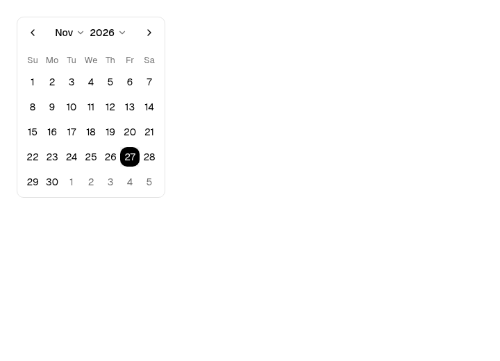
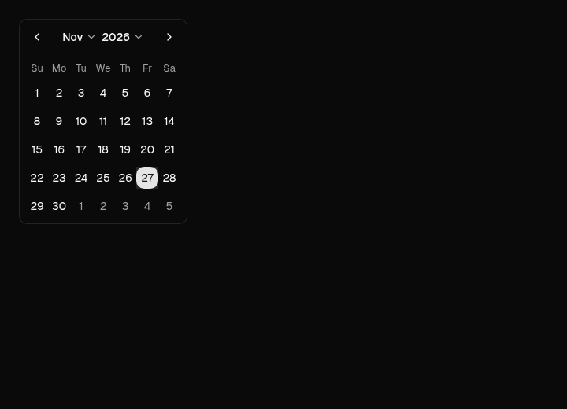

# Calendar

上游示例样式为 `base-nova`。 [官方示例](https://ui.shadcn.com/examples/base/calendar-demo) · [示例源码](https://github.com/shadcn-ui/ui/blob/0e5b2e621a9ee4cf6a604bbe6c5c0d5b70561eb4/apps/v4/examples/base/calendar-demo.tsx) · [采集记录](./provenance.json)

| 序号 | 状态 | 主题 | 截图 |
| ---: | --- | --- | --- |
| 1 | 初始态 | 浅色 |  |
| 2 | 初始态 | 深色 |  |

## 变体和交互状态

[采集记录](coverage.json)

| 序号 | 官方示例 | 变体 | 截图状态 | 示例样式 | 参考截图 |
| ---: | --- | --- | --- | --- | --- |
| 1 | [calendar-basic](https://ui.shadcn.com/examples/base/calendar-basic) | `basic` | `initial` | `base-nova` | [浅色](calendar-basic-initial-light.png) · [深色](calendar-basic-initial-dark.png) |
| 2 | [calendar-booked-dates](https://ui.shadcn.com/examples/base/calendar-booked-dates) | `booked-dates` | `initial` | `base-nova` | [浅色](calendar-booked-dates-initial-light.png) · [深色](calendar-booked-dates-initial-dark.png) |
| 3 | [calendar-caption](https://ui.shadcn.com/examples/base/calendar-caption) | `caption` | `initial` | `base-nova` | [浅色](calendar-caption-initial-light.png) · [深色](calendar-caption-initial-dark.png) |
| 4 | [calendar-custom-days](https://ui.shadcn.com/examples/base/calendar-custom-days) | `custom-days` | `initial` | `base-nova` | [浅色](calendar-custom-days-initial-light.png) · [深色](calendar-custom-days-initial-dark.png) |
| 5 | [calendar-hijri](https://ui.shadcn.com/examples/base/calendar-hijri) | `hijri` | `initial` | `base-nova` | [浅色](calendar-hijri-initial-light.png) · [深色](calendar-hijri-initial-dark.png) |
| 6 | [calendar-multiple](https://ui.shadcn.com/examples/base/calendar-multiple) | `multiple` | `initial` | `base-nova` | [浅色](calendar-multiple-initial-light.png) · [深色](calendar-multiple-initial-dark.png) |
| 7 | [calendar-presets](https://ui.shadcn.com/examples/base/calendar-presets) | `presets` | `initial` | `base-nova` | [浅色](calendar-presets-initial-light.png) · [深色](calendar-presets-initial-dark.png) |
| 8 | [calendar-range](https://ui.shadcn.com/examples/base/calendar-range) | `range` | `initial` | `base-nova` | [浅色](calendar-range-initial-light.png) · [深色](calendar-range-initial-dark.png) |
| 9 | [calendar-rtl](https://ui.shadcn.com/examples/base/calendar-rtl) | `rtl` | `initial` | `example-defined` | [浅色](calendar-rtl-initial-light.png) · [深色](calendar-rtl-initial-dark.png) |
| 10 | [calendar-time](https://ui.shadcn.com/examples/base/calendar-time) | `time` | `initial` | `base-nova` | [浅色](calendar-time-initial-light.png) · [深色](calendar-time-initial-dark.png) |
| 11 | [calendar-week-numbers](https://ui.shadcn.com/examples/base/calendar-week-numbers) | `week-numbers` | `initial` | `base-nova` | [浅色](calendar-week-numbers-initial-light.png) · [深色](calendar-week-numbers-initial-dark.png) |
