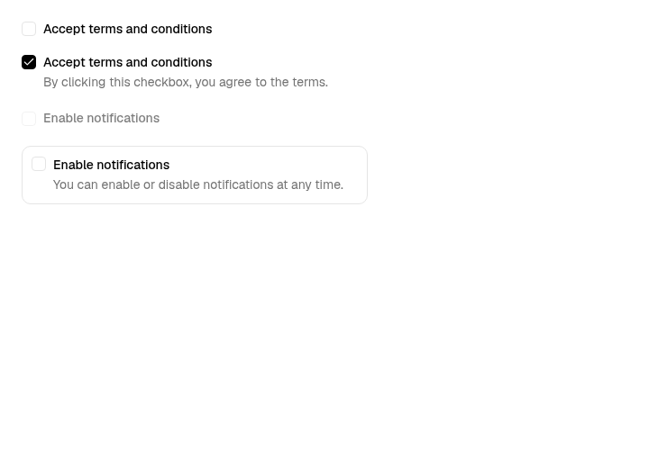
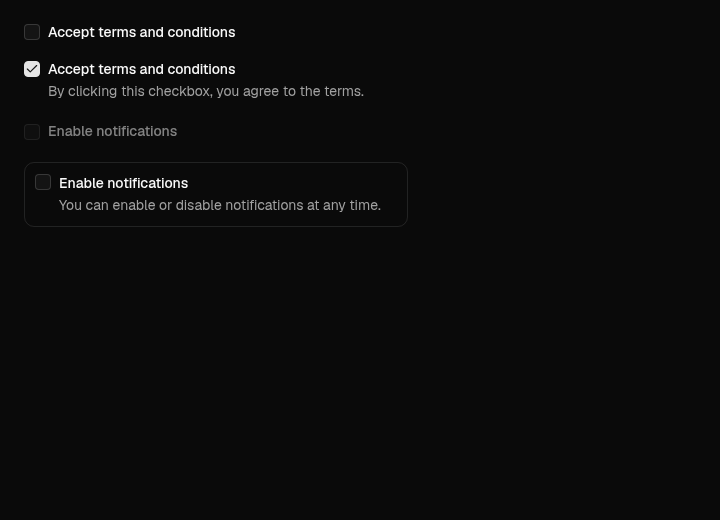

# Checkbox

上游示例样式为 `base-nova`。 [官方示例](https://ui.shadcn.com/examples/base/checkbox-demo) · [示例源码](https://github.com/shadcn-ui/ui/blob/0e5b2e621a9ee4cf6a604bbe6c5c0d5b70561eb4/apps/v4/examples/base/checkbox-demo.tsx) · [采集记录](./provenance.json)

| 状态 | 主题 | 截图 |
| --- | --- | --- |
| 初始态 | 浅色 |  |
| 初始态 | 深色 |  |

## 变体和交互状态

[采集记录](coverage.json)

| 官方示例 | 变体 | 截图状态 | 示例样式 | 参考截图 |
| --- | --- | --- | --- | --- |
| [checkbox-basic](https://ui.shadcn.com/examples/base/checkbox-basic) | `basic` | `initial` | `base-nova` | [浅色](checkbox-basic-initial-light.png) · [深色](checkbox-basic-initial-dark.png) |
| [checkbox-demo](https://ui.shadcn.com/examples/base/checkbox-demo) | `default` | `checked` | `base-nova` | [浅色](checkbox-default-checked-light.png) · [深色](checkbox-default-checked-dark.png) |
| [checkbox-description](https://ui.shadcn.com/examples/base/checkbox-description) | `description` | `initial` | `base-nova` | [浅色](checkbox-description-initial-light.png) · [深色](checkbox-description-initial-dark.png) |
| [checkbox-disabled](https://ui.shadcn.com/examples/base/checkbox-disabled) | `disabled` | `initial` | `base-nova` | [浅色](checkbox-disabled-initial-light.png) · [深色](checkbox-disabled-initial-dark.png) |
| [checkbox-group](https://ui.shadcn.com/examples/base/checkbox-group) | `group` | `initial` | `base-nova` | [浅色](checkbox-group-initial-light.png) · [深色](checkbox-group-initial-dark.png) |
| [checkbox-invalid](https://ui.shadcn.com/examples/base/checkbox-invalid) | `invalid` | `initial` | `base-nova` | [浅色](checkbox-invalid-initial-light.png) · [深色](checkbox-invalid-initial-dark.png) |
| [checkbox-rtl](https://ui.shadcn.com/examples/base/checkbox-rtl) | `rtl` | `initial` | `example-defined` | [浅色](checkbox-rtl-initial-light.png) · [深色](checkbox-rtl-initial-dark.png) |
| [checkbox-table](https://ui.shadcn.com/examples/base/checkbox-table) | `table` | `initial` | `base-nova` | [浅色](checkbox-table-initial-light.png) · [深色](checkbox-table-initial-dark.png) |
