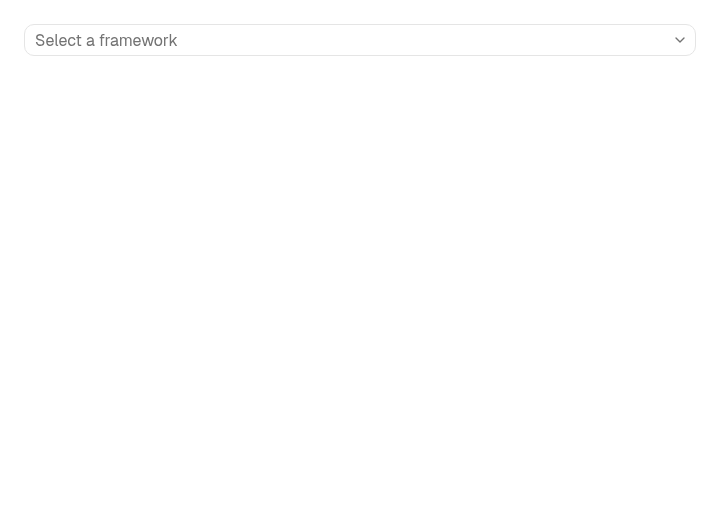
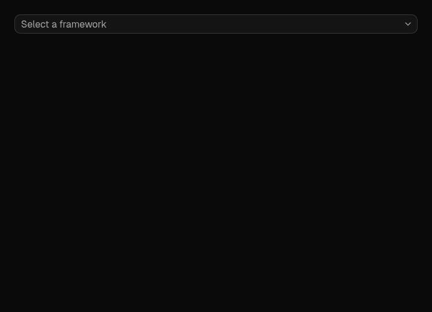

# Combobox

上游示例样式为 `base-nova`。 [官方示例](https://ui.shadcn.com/examples/base/combobox-demo) · [示例源码](https://github.com/shadcn-ui/ui/blob/0e5b2e621a9ee4cf6a604bbe6c5c0d5b70561eb4/apps/v4/examples/base/combobox-demo.tsx) · [采集记录](./provenance.json)

| 序号 | 状态 | 主题 | 截图 |
| ---: | --- | --- | --- |
| 1 | 初始态 | 浅色 |  |
| 2 | 初始态 | 深色 |  |

## 变体和交互状态

[采集记录](coverage.json)

| 序号 | 官方示例 | 变体 | 截图状态 | 示例样式 | 参考截图 |
| ---: | --- | --- | --- | --- | --- |
| 1 | [combobox-auto-highlight](https://ui.shadcn.com/examples/base/combobox-auto-highlight) | `auto-highlight` | `initial` | `base-nova` | [浅色](combobox-auto-highlight-initial-light.png) · [深色](combobox-auto-highlight-initial-dark.png) |
| 2 | [combobox-basic](https://ui.shadcn.com/examples/base/combobox-basic) | `basic` | `initial` | `base-nova` | [浅色](combobox-basic-initial-light.png) · [深色](combobox-basic-initial-dark.png) |
| 3 | [combobox-clear](https://ui.shadcn.com/examples/base/combobox-clear) | `clear` | `initial` | `base-nova` | [浅色](combobox-clear-initial-light.png) · [深色](combobox-clear-initial-dark.png) |
| 4 | [combobox-custom](https://ui.shadcn.com/examples/base/combobox-custom) | `custom` | `initial` | `base-nova` | [浅色](combobox-custom-initial-light.png) · [深色](combobox-custom-initial-dark.png) |
| 5 | [combobox-disabled](https://ui.shadcn.com/examples/base/combobox-disabled) | `disabled` | `initial` | `base-nova` | [浅色](combobox-disabled-initial-light.png) · [深色](combobox-disabled-initial-dark.png) |
| 6 | [combobox-demo](https://ui.shadcn.com/examples/base/combobox-demo) | `default` | `empty` | `base-nova` | [浅色](combobox-default-empty-light.png) · [深色](combobox-default-empty-dark.png) |
| 7 | [combobox-groups](https://ui.shadcn.com/examples/base/combobox-groups) | `groups` | `initial` | `base-nova` | [浅色](combobox-groups-initial-light.png) · [深色](combobox-groups-initial-dark.png) |
| 8 | [combobox-groups](https://ui.shadcn.com/examples/base/combobox-groups) | `groups` | `open` | `base-nova` | [浅色](combobox-groups-open-light.png) · [深色](combobox-groups-open-dark.png) |
| 9 | [combobox-input-group](https://ui.shadcn.com/examples/base/combobox-input-group) | `input-group` | `initial` | `base-nova` | [浅色](combobox-input-group-initial-light.png) · [深色](combobox-input-group-initial-dark.png) |
| 10 | [combobox-invalid](https://ui.shadcn.com/examples/base/combobox-invalid) | `invalid` | `initial` | `base-nova` | [浅色](combobox-invalid-initial-light.png) · [深色](combobox-invalid-initial-dark.png) |
| 11 | [combobox-multiple](https://ui.shadcn.com/examples/base/combobox-multiple) | `multiple` | `initial` | `base-nova` | [浅色](combobox-multiple-initial-light.png) · [深色](combobox-multiple-initial-dark.png) |
| 12 | [combobox-demo](https://ui.shadcn.com/examples/base/combobox-demo) | `default` | `open` | `base-nova` | [浅色](combobox-default-open-light.png) · [深色](combobox-default-open-dark.png) |
| 13 | [combobox-popup](https://ui.shadcn.com/examples/base/combobox-popup) | `popup` | `initial` | `base-nova` | [浅色](combobox-popup-initial-light.png) · [深色](combobox-popup-initial-dark.png) |
| 14 | [combobox-rtl](https://ui.shadcn.com/examples/base/combobox-rtl) | `rtl` | `initial` | `example-defined` | [浅色](combobox-rtl-initial-light.png) · [深色](combobox-rtl-initial-dark.png) |
| 15 | [combobox-demo](https://ui.shadcn.com/examples/base/combobox-demo) | `default` | `keyboard-focused` | `base-nova` | [浅色](combobox-default-keyboard-focused-light.png) · [深色](combobox-default-keyboard-focused-dark.png) |
