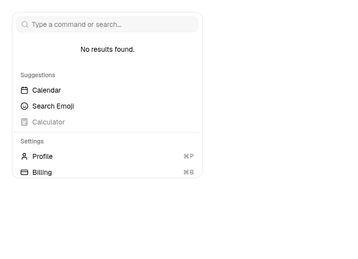
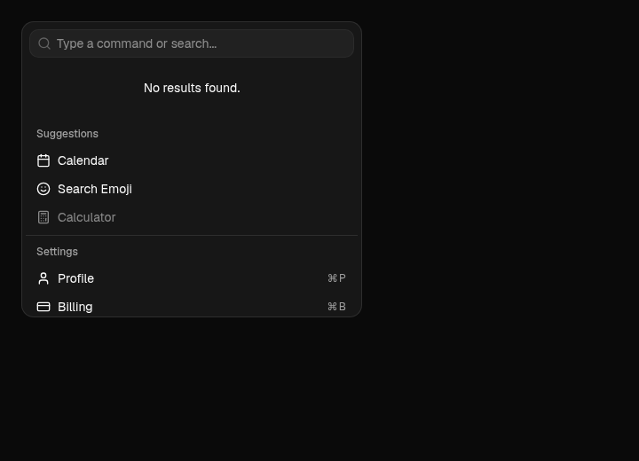

# Command

上游示例样式为 `base-nova`。 [官方示例](https://ui.shadcn.com/examples/base/command-demo) · [示例源码](https://github.com/shadcn-ui/ui/blob/0e5b2e621a9ee4cf6a604bbe6c5c0d5b70561eb4/apps/v4/examples/base/command-demo.tsx) · [采集记录](./provenance.json)

| 序号 | 状态 | 主题 | 截图 |
| ---: | --- | --- | --- |
| 1 | 初始态 | 浅色 |  |
| 2 | 初始态 | 深色 |  |

## 变体和交互状态

[采集记录](coverage.json)

| 序号 | 官方示例 | 变体 | 截图状态 | 示例样式 | 参考截图 |
| ---: | --- | --- | --- | --- | --- |
| 1 | [command-basic](https://ui.shadcn.com/examples/base/command-basic) | `basic` | `initial` | `base-nova` | [浅色](command-basic-initial-light.png) · [深色](command-basic-initial-dark.png) |
| 2 | [command-dialog](https://ui.shadcn.com/examples/base/command-dialog) | `dialog` | `initial` | `base-nova` | [浅色](command-dialog-initial-light.png) · [深色](command-dialog-initial-dark.png) |
| 3 | [command-demo](https://ui.shadcn.com/examples/base/command-demo) | `default` | `filtered` | `base-nova` | [浅色](command-default-filtered-light.png) · [深色](command-default-filtered-dark.png) |
| 4 | [command-groups](https://ui.shadcn.com/examples/base/command-groups) | `groups` | `initial` | `base-nova` | [浅色](command-groups-initial-light.png) · [深色](command-groups-initial-dark.png) |
| 5 | [command-rtl](https://ui.shadcn.com/examples/base/command-rtl) | `rtl` | `initial` | `example-defined` | [浅色](command-rtl-initial-light.png) · [深色](command-rtl-initial-dark.png) |
| 6 | [command-scrollable](https://ui.shadcn.com/examples/base/command-scrollable) | `scrollable` | `initial` | `base-nova` | [浅色](command-scrollable-initial-light.png) · [深色](command-scrollable-initial-dark.png) |
| 7 | [command-shortcuts](https://ui.shadcn.com/examples/base/command-shortcuts) | `shortcuts` | `initial` | `base-nova` | [浅色](command-shortcuts-initial-light.png) · [深色](command-shortcuts-initial-dark.png) |
| 8 | [command-demo](https://ui.shadcn.com/examples/base/command-demo) | `default` | `keyboard-navigated` | `base-nova` | [浅色](command-default-keyboard-navigated-light.png) · [深色](command-default-keyboard-navigated-dark.png) |
| 9 | [command-shortcuts](https://ui.shadcn.com/examples/base/command-shortcuts) | `shortcuts` | `open` | `base-nova` | [浅色](command-shortcuts-open-light.png) · [深色](command-shortcuts-open-dark.png) |
