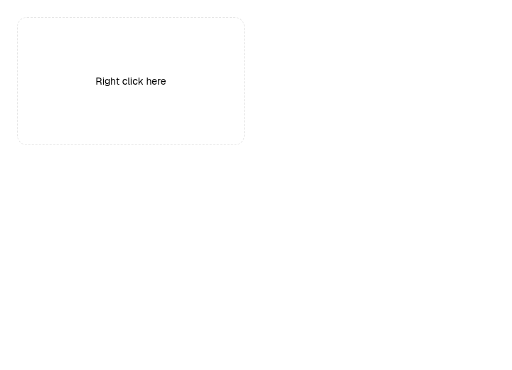
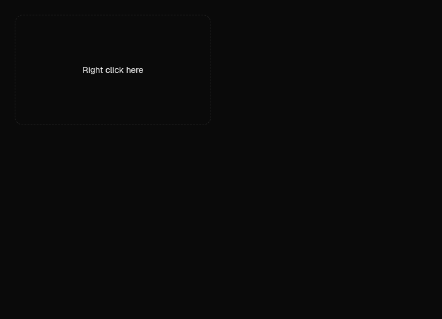

# Context Menu

上游示例样式为 `base-nova`。 [官方示例](https://ui.shadcn.com/examples/base/context-menu-demo) · [示例源码](https://github.com/shadcn-ui/ui/blob/0e5b2e621a9ee4cf6a604bbe6c5c0d5b70561eb4/apps/v4/examples/base/context-menu-demo.tsx) · [采集记录](./provenance.json)

| 状态 | 主题 | 截图 |
| --- | --- | --- |
| 初始态 | 浅色 |  |
| 初始态 | 深色 |  |

## 变体和交互状态

[采集记录](coverage.json)

| 官方示例 | 变体 | 截图状态 | 示例样式 | 参考截图 |
| --- | --- | --- | --- | --- |
| [context-menu-basic](https://ui.shadcn.com/examples/base/context-menu-basic) | `basic` | `initial` | `base-nova` | [浅色](context-menu-basic-initial-light.png) · [深色](context-menu-basic-initial-dark.png) |
| [context-menu-checkboxes](https://ui.shadcn.com/examples/base/context-menu-checkboxes) | `checkboxes` | `initial` | `base-nova` | [浅色](context-menu-checkboxes-initial-light.png) · [深色](context-menu-checkboxes-initial-dark.png) |
| [context-menu-checkboxes](https://ui.shadcn.com/examples/base/context-menu-checkboxes) | `checkboxes` | `open` | `base-nova` | [浅色](context-menu-checkboxes-open-light.png) · [深色](context-menu-checkboxes-open-dark.png) |
| [context-menu-destructive](https://ui.shadcn.com/examples/base/context-menu-destructive) | `destructive` | `initial` | `base-nova` | [浅色](context-menu-destructive-initial-light.png) · [深色](context-menu-destructive-initial-dark.png) |
| [context-menu-groups](https://ui.shadcn.com/examples/base/context-menu-groups) | `groups` | `initial` | `base-nova` | [浅色](context-menu-groups-initial-light.png) · [深色](context-menu-groups-initial-dark.png) |
| [context-menu-icons](https://ui.shadcn.com/examples/base/context-menu-icons) | `icons` | `initial` | `base-nova` | [浅色](context-menu-icons-initial-light.png) · [深色](context-menu-icons-initial-dark.png) |
| [context-menu-demo](https://ui.shadcn.com/examples/base/context-menu-demo) | `default` | `open` | `base-nova` | [浅色](context-menu-default-open-light.png) · [深色](context-menu-default-open-dark.png) |
| [context-menu-radio](https://ui.shadcn.com/examples/base/context-menu-radio) | `radio` | `initial` | `base-nova` | [浅色](context-menu-radio-initial-light.png) · [深色](context-menu-radio-initial-dark.png) |
| [context-menu-radio](https://ui.shadcn.com/examples/base/context-menu-radio) | `radio` | `open` | `base-nova` | [浅色](context-menu-radio-open-light.png) · [深色](context-menu-radio-open-dark.png) |
| [context-menu-rtl](https://ui.shadcn.com/examples/base/context-menu-rtl) | `rtl` | `initial` | `example-defined` | [浅色](context-menu-rtl-initial-light.png) · [深色](context-menu-rtl-initial-dark.png) |
| [context-menu-shortcuts](https://ui.shadcn.com/examples/base/context-menu-shortcuts) | `shortcuts` | `initial` | `base-nova` | [浅色](context-menu-shortcuts-initial-light.png) · [深色](context-menu-shortcuts-initial-dark.png) |
| [context-menu-sides](https://ui.shadcn.com/examples/base/context-menu-sides) | `sides` | `initial` | `base-nova` | [浅色](context-menu-sides-initial-light.png) · [深色](context-menu-sides-initial-dark.png) |
| [context-menu-submenu](https://ui.shadcn.com/examples/base/context-menu-submenu) | `submenu` | `initial` | `base-nova` | [浅色](context-menu-submenu-initial-light.png) · [深色](context-menu-submenu-initial-dark.png) |
| [context-menu-submenu](https://ui.shadcn.com/examples/base/context-menu-submenu) | `submenu` | `open` | `base-nova` | [浅色](context-menu-submenu-open-light.png) · [深色](context-menu-submenu-open-dark.png) |
