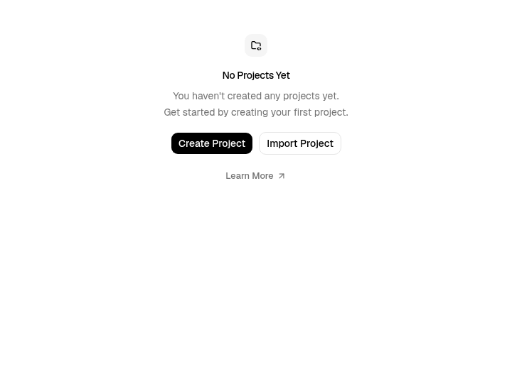
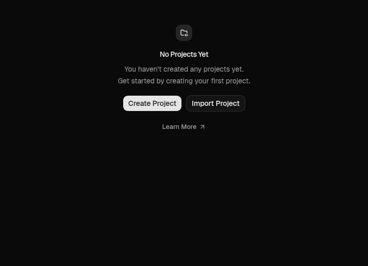

# Empty

上游示例样式为 `base-nova`。 [官方示例](https://ui.shadcn.com/examples/base/empty-demo) · [示例源码](https://github.com/shadcn-ui/ui/blob/0e5b2e621a9ee4cf6a604bbe6c5c0d5b70561eb4/apps/v4/examples/base/empty-demo.tsx) · [采集记录](./provenance.json)

| 序号 | 状态 | 主题 | 截图 |
| ---: | --- | --- | --- |
| 1 | 初始态 | 浅色 |  |
| 2 | 初始态 | 深色 |  |

## 变体和交互状态

[采集记录](coverage.json)

| 序号 | 官方示例 | 变体 | 截图状态 | 示例样式 | 参考截图 |
| ---: | --- | --- | --- | --- | --- |
| 1 | [empty-avatar](https://ui.shadcn.com/examples/base/empty-avatar) | `avatar` | `initial` | `base-nova` | [浅色](empty-avatar-initial-light.png) · [深色](empty-avatar-initial-dark.png) |
| 2 | [empty-avatar-group](https://ui.shadcn.com/examples/base/empty-avatar-group) | `avatar-group` | `initial` | `base-nova` | [浅色](empty-avatar-group-initial-light.png) · [深色](empty-avatar-group-initial-dark.png) |
| 3 | [empty-background](https://ui.shadcn.com/examples/base/empty-background) | `background` | `initial` | `base-nova` | [浅色](empty-background-initial-light.png) · [深色](empty-background-initial-dark.png) |
| 4 | [empty-card](https://ui.shadcn.com/examples/base/empty-card) | `card` | `initial` | `base-nova` | [浅色](empty-card-initial-light.png) · [深色](empty-card-initial-dark.png) |
| 5 | [empty-input-group](https://ui.shadcn.com/examples/base/empty-input-group) | `input-group` | `initial` | `base-nova` | [浅色](empty-input-group-initial-light.png) · [深色](empty-input-group-initial-dark.png) |
| 6 | [empty-outline](https://ui.shadcn.com/examples/base/empty-outline) | `outline` | `initial` | `base-nova` | [浅色](empty-outline-initial-light.png) · [深色](empty-outline-initial-dark.png) |
| 7 | [empty-rtl](https://ui.shadcn.com/examples/base/empty-rtl) | `rtl` | `initial` | `example-defined` | [浅色](empty-rtl-initial-light.png) · [深色](empty-rtl-initial-dark.png) |
| 8 | [empty-demo](https://ui.shadcn.com/examples/base/empty-demo) | `default` | `keyboard-focused` | `base-nova` | [浅色](empty-default-keyboard-focused-light.png) · [深色](empty-default-keyboard-focused-dark.png) |
