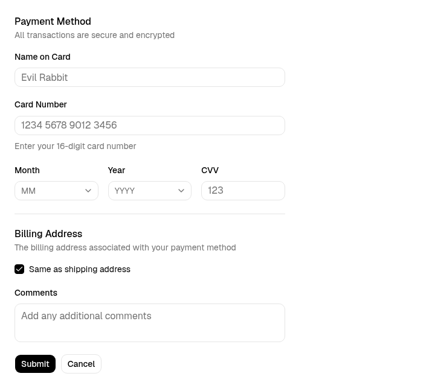
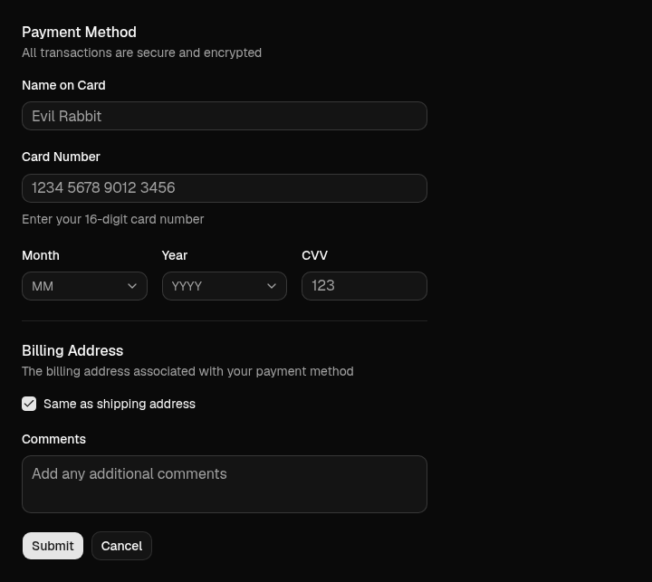

# Field

上游示例样式为 `base-nova`。 [官方示例](https://ui.shadcn.com/examples/base/field-demo) · [示例源码](https://github.com/shadcn-ui/ui/blob/0e5b2e621a9ee4cf6a604bbe6c5c0d5b70561eb4/apps/v4/examples/base/field-demo.tsx) · [采集记录](./provenance.json)

| 状态 | 主题 | 截图 |
| --- | --- | --- |
| 初始态 | 浅色 |  |
| 初始态 | 深色 |  |

## 变体和交互状态

[采集记录](coverage.json)

| 官方示例 | 变体 | 截图状态 | 示例样式 | 参考截图 |
| --- | --- | --- | --- | --- |
| [field-checkbox](https://ui.shadcn.com/examples/base/field-checkbox) | `checkbox` | `initial` | `base-nova` | [浅色](field-checkbox-initial-light.png) · [深色](field-checkbox-initial-dark.png) |
| [field-choice-card](https://ui.shadcn.com/examples/base/field-choice-card) | `choice-card` | `initial` | `base-nova` | [浅色](field-choice-card-initial-light.png) · [深色](field-choice-card-initial-dark.png) |
| [field-fieldset](https://ui.shadcn.com/examples/base/field-fieldset) | `fieldset` | `initial` | `base-nova` | [浅色](field-fieldset-initial-light.png) · [深色](field-fieldset-initial-dark.png) |
| [field-group](https://ui.shadcn.com/examples/base/field-group) | `group` | `initial` | `base-nova` | [浅色](field-group-initial-light.png) · [深色](field-group-initial-dark.png) |
| [field-input](https://ui.shadcn.com/examples/base/field-input) | `input` | `initial` | `base-nova` | [浅色](field-input-initial-light.png) · [深色](field-input-initial-dark.png) |
| [field-radio](https://ui.shadcn.com/examples/base/field-radio) | `radio` | `initial` | `base-nova` | [浅色](field-radio-initial-light.png) · [深色](field-radio-initial-dark.png) |
| [field-responsive](https://ui.shadcn.com/examples/base/field-responsive) | `responsive` | `initial` | `base-nova` | [浅色](field-responsive-initial-light.png) · [深色](field-responsive-initial-dark.png) |
| [field-rtl](https://ui.shadcn.com/examples/base/field-rtl) | `rtl` | `initial` | `example-defined` | [浅色](field-rtl-initial-light.png) · [深色](field-rtl-initial-dark.png) |
| [field-select](https://ui.shadcn.com/examples/base/field-select) | `select` | `initial` | `base-nova` | [浅色](field-select-initial-light.png) · [深色](field-select-initial-dark.png) |
| [field-slider](https://ui.shadcn.com/examples/base/field-slider) | `slider` | `initial` | `base-nova` | [浅色](field-slider-initial-light.png) · [深色](field-slider-initial-dark.png) |
| [field-switch](https://ui.shadcn.com/examples/base/field-switch) | `switch` | `initial` | `base-nova` | [浅色](field-switch-initial-light.png) · [深色](field-switch-initial-dark.png) |
| [field-textarea](https://ui.shadcn.com/examples/base/field-textarea) | `textarea` | `initial` | `base-nova` | [浅色](field-textarea-initial-light.png) · [深色](field-textarea-initial-dark.png) |
