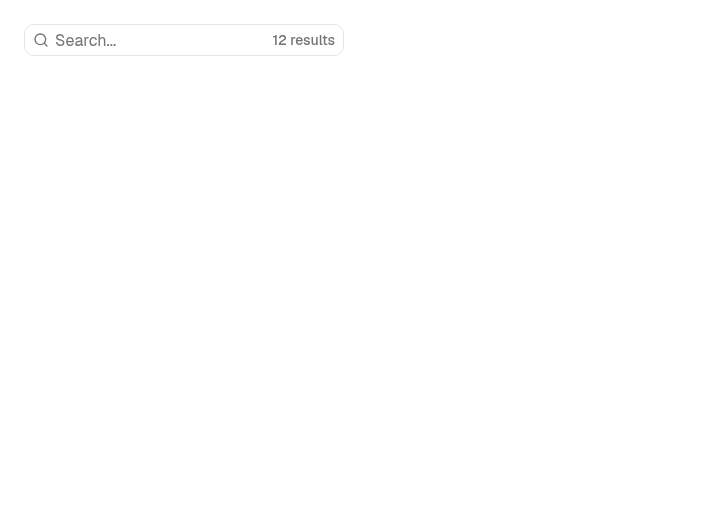
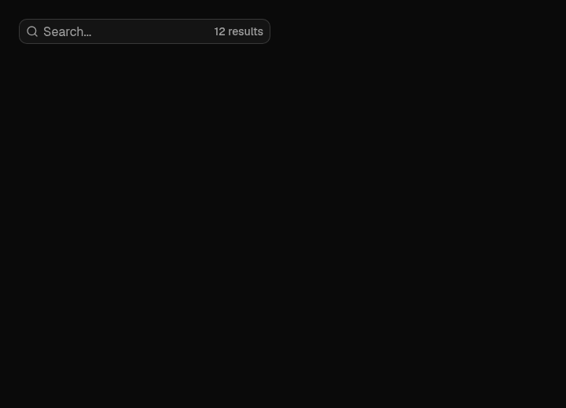

# Input Group

上游示例样式为 `base-nova`。 [官方示例](https://ui.shadcn.com/examples/base/input-group-demo) · [示例源码](https://github.com/shadcn-ui/ui/blob/0e5b2e621a9ee4cf6a604bbe6c5c0d5b70561eb4/apps/v4/examples/base/input-group-demo.tsx) · [采集记录](./provenance.json)

| 序号 | 状态 | 主题 | 截图 |
| ---: | --- | --- | --- |
| 1 | 初始态 | 浅色 |  |
| 2 | 初始态 | 深色 |  |

## 变体和交互状态

[采集记录](coverage.json)

| 序号 | 官方示例 | 变体 | 截图状态 | 示例样式 | 参考截图 |
| ---: | --- | --- | --- | --- | --- |
| 1 | [input-group-basic](https://ui.shadcn.com/examples/base/input-group-basic) | `basic` | `initial` | `base-nova` | [浅色](input-group-basic-initial-light.png) · [深色](input-group-basic-initial-dark.png) |
| 2 | [input-group-block-end](https://ui.shadcn.com/examples/base/input-group-block-end) | `block-end` | `initial` | `base-nova` | [浅色](input-group-block-end-initial-light.png) · [深色](input-group-block-end-initial-dark.png) |
| 3 | [input-group-block-start](https://ui.shadcn.com/examples/base/input-group-block-start) | `block-start` | `initial` | `base-nova` | [浅色](input-group-block-start-initial-light.png) · [深色](input-group-block-start-initial-dark.png) |
| 4 | [input-group-button](https://ui.shadcn.com/examples/base/input-group-button) | `button` | `initial` | `base-nova` | [浅色](input-group-button-initial-light.png) · [深色](input-group-button-initial-dark.png) |
| 5 | [input-group-button-group](https://ui.shadcn.com/examples/base/input-group-button-group) | `button-group` | `initial` | `base-nova` | [浅色](input-group-button-group-initial-light.png) · [深色](input-group-button-group-initial-dark.png) |
| 6 | [input-group-custom](https://ui.shadcn.com/examples/base/input-group-custom) | `custom` | `initial` | `base-nova` | [浅色](input-group-custom-initial-light.png) · [深色](input-group-custom-initial-dark.png) |
| 7 | [input-group-dropdown](https://ui.shadcn.com/examples/base/input-group-dropdown) | `dropdown` | `initial` | `base-nova` | [浅色](input-group-dropdown-initial-light.png) · [深色](input-group-dropdown-initial-dark.png) |
| 8 | [input-group-icon](https://ui.shadcn.com/examples/base/input-group-icon) | `icon` | `initial` | `base-nova` | [浅色](input-group-icon-initial-light.png) · [深色](input-group-icon-initial-dark.png) |
| 9 | [input-group-in-card](https://ui.shadcn.com/examples/base/input-group-in-card) | `in-card` | `initial` | `base-nova` | [浅色](input-group-in-card-initial-light.png) · [深色](input-group-in-card-initial-dark.png) |
| 10 | [input-group-inline-end](https://ui.shadcn.com/examples/base/input-group-inline-end) | `inline-end` | `initial` | `base-nova` | [浅色](input-group-inline-end-initial-light.png) · [深色](input-group-inline-end-initial-dark.png) |
| 11 | [input-group-inline-start](https://ui.shadcn.com/examples/base/input-group-inline-start) | `inline-start` | `initial` | `base-nova` | [浅色](input-group-inline-start-initial-light.png) · [深色](input-group-inline-start-initial-dark.png) |
| 12 | [input-group-kbd](https://ui.shadcn.com/examples/base/input-group-kbd) | `kbd` | `initial` | `base-nova` | [浅色](input-group-kbd-initial-light.png) · [深色](input-group-kbd-initial-dark.png) |
| 13 | [input-group-label](https://ui.shadcn.com/examples/base/input-group-label) | `label` | `initial` | `base-nova` | [浅色](input-group-label-initial-light.png) · [深色](input-group-label-initial-dark.png) |
| 14 | [input-group-rtl](https://ui.shadcn.com/examples/base/input-group-rtl) | `rtl` | `initial` | `example-defined` | [浅色](input-group-rtl-initial-light.png) · [深色](input-group-rtl-initial-dark.png) |
| 15 | [input-group-spinner](https://ui.shadcn.com/examples/base/input-group-spinner) | `spinner` | `initial` | `base-nova` | [浅色](input-group-spinner-initial-light.png) · [深色](input-group-spinner-initial-dark.png) |
| 16 | [input-group-text](https://ui.shadcn.com/examples/base/input-group-text) | `text` | `initial` | `base-nova` | [浅色](input-group-text-initial-light.png) · [深色](input-group-text-initial-dark.png) |
| 17 | [input-group-textarea](https://ui.shadcn.com/examples/base/input-group-textarea) | `textarea` | `initial` | `base-nova` | [浅色](input-group-textarea-initial-light.png) · [深色](input-group-textarea-initial-dark.png) |
| 18 | [input-group-textarea-examples](https://ui.shadcn.com/examples/base/input-group-textarea-examples) | `textarea-examples` | `initial` | `base-nova` | [浅色](input-group-textarea-examples-initial-light.png) · [深色](input-group-textarea-examples-initial-dark.png) |
| 19 | [input-group-tooltip](https://ui.shadcn.com/examples/base/input-group-tooltip) | `tooltip` | `initial` | `base-nova` | [浅色](input-group-tooltip-initial-light.png) · [深色](input-group-tooltip-initial-dark.png) |
| 20 | [input-group-with-addons](https://ui.shadcn.com/examples/base/input-group-with-addons) | `with-addons` | `initial` | `base-nova` | [浅色](input-group-with-addons-initial-light.png) · [深色](input-group-with-addons-initial-dark.png) |
| 21 | [input-group-with-buttons](https://ui.shadcn.com/examples/base/input-group-with-buttons) | `with-buttons` | `initial` | `base-nova` | [浅色](input-group-with-buttons-initial-light.png) · [深色](input-group-with-buttons-initial-dark.png) |
| 22 | [input-group-with-kbd](https://ui.shadcn.com/examples/base/input-group-with-kbd) | `with-kbd` | `initial` | `base-nova` | [浅色](input-group-with-kbd-initial-light.png) · [深色](input-group-with-kbd-initial-dark.png) |
| 23 | [input-group-with-tooltip](https://ui.shadcn.com/examples/base/input-group-with-tooltip) | `with-tooltip` | `initial` | `base-nova` | [浅色](input-group-with-tooltip-initial-light.png) · [深色](input-group-with-tooltip-initial-dark.png) |
