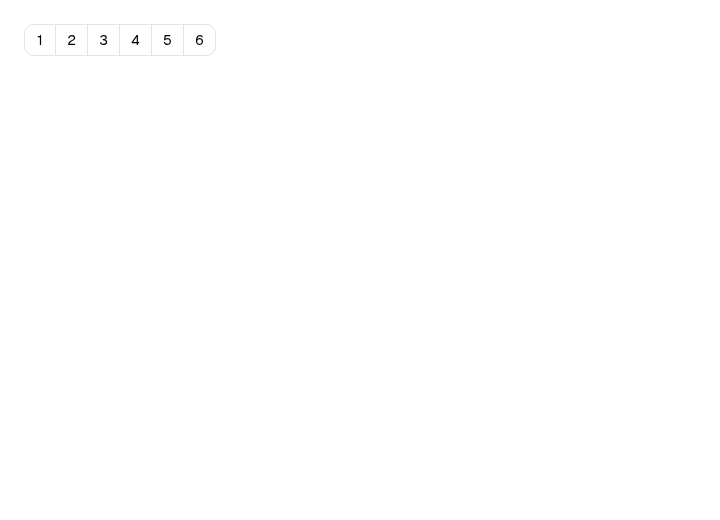
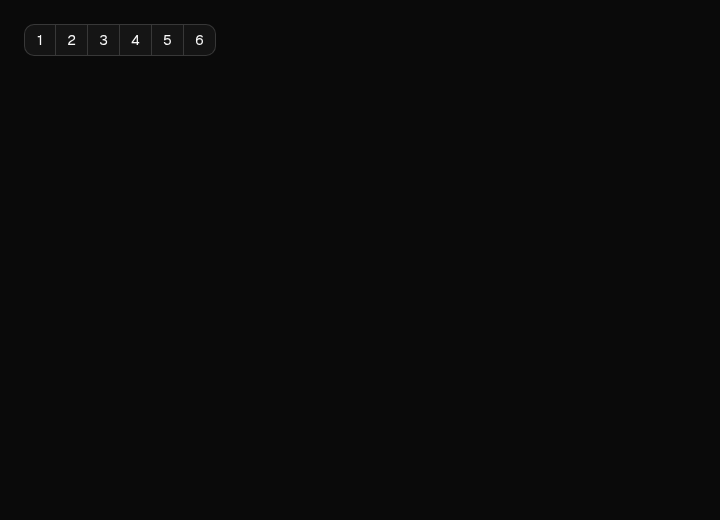

# Input OTP

上游示例样式为 `base-nova`。 [官方示例](https://ui.shadcn.com/examples/base/input-otp-demo) · [示例源码](https://github.com/shadcn-ui/ui/blob/0e5b2e621a9ee4cf6a604bbe6c5c0d5b70561eb4/apps/v4/examples/base/input-otp-demo.tsx) · [采集记录](./provenance.json)

| 序号 | 状态 | 主题 | 截图 |
| ---: | --- | --- | --- |
| 1 | 初始态 | 浅色 |  |
| 2 | 初始态 | 深色 |  |

## 变体和交互状态

[采集记录](coverage.json)

| 序号 | 官方示例 | 变体 | 截图状态 | 示例样式 | 参考截图 |
| ---: | --- | --- | --- | --- | --- |
| 1 | [input-otp-alphanumeric](https://ui.shadcn.com/examples/base/input-otp-alphanumeric) | `alphanumeric` | `initial` | `base-nova` | [浅色](input-otp-alphanumeric-initial-light.png) · [深色](input-otp-alphanumeric-initial-dark.png) |
| 2 | [input-otp-controlled](https://ui.shadcn.com/examples/base/input-otp-controlled) | `controlled` | `initial` | `base-nova` | [浅色](input-otp-controlled-initial-light.png) · [深色](input-otp-controlled-initial-dark.png) |
| 3 | [input-otp-disabled](https://ui.shadcn.com/examples/base/input-otp-disabled) | `disabled` | `initial` | `base-nova` | [浅色](input-otp-disabled-initial-light.png) · [深色](input-otp-disabled-initial-dark.png) |
| 4 | [input-otp-form](https://ui.shadcn.com/examples/base/input-otp-form) | `form` | `initial` | `base-nova` | [浅色](input-otp-form-initial-light.png) · [深色](input-otp-form-initial-dark.png) |
| 5 | [input-otp-four-digits](https://ui.shadcn.com/examples/base/input-otp-four-digits) | `four-digits` | `initial` | `base-nova` | [浅色](input-otp-four-digits-initial-light.png) · [深色](input-otp-four-digits-initial-dark.png) |
| 6 | [input-otp-invalid](https://ui.shadcn.com/examples/base/input-otp-invalid) | `invalid` | `initial` | `base-nova` | [浅色](input-otp-invalid-initial-light.png) · [深色](input-otp-invalid-initial-dark.png) |
| 7 | [input-otp-pattern](https://ui.shadcn.com/examples/base/input-otp-pattern) | `pattern` | `initial` | `base-nova` | [浅色](input-otp-pattern-initial-light.png) · [深色](input-otp-pattern-initial-dark.png) |
| 8 | [input-otp-rtl](https://ui.shadcn.com/examples/base/input-otp-rtl) | `rtl` | `initial` | `example-defined` | [浅色](input-otp-rtl-initial-light.png) · [深色](input-otp-rtl-initial-dark.png) |
| 9 | [input-otp-separator](https://ui.shadcn.com/examples/base/input-otp-separator) | `separator` | `initial` | `base-nova` | [浅色](input-otp-separator-initial-light.png) · [深色](input-otp-separator-initial-dark.png) |
| 10 | [input-otp-demo](https://ui.shadcn.com/examples/base/input-otp-demo) | `default` | `keyboard-focused` | `base-nova` | [浅色](input-otp-default-keyboard-focused-light.png) · [深色](input-otp-default-keyboard-focused-dark.png) |
