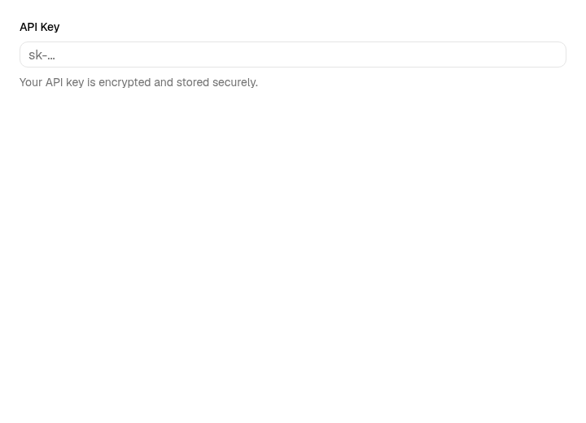
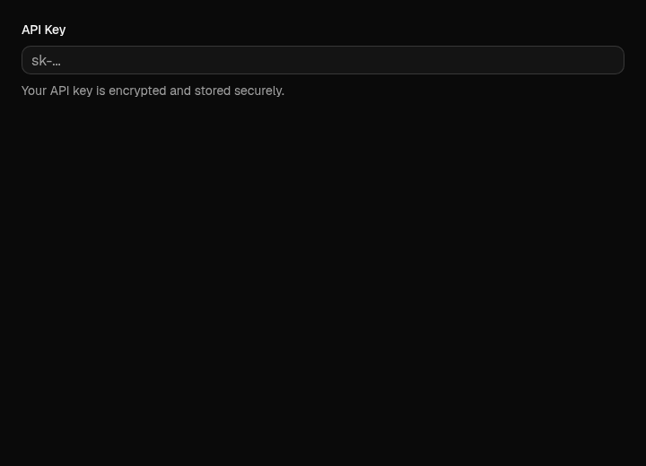

# Input

上游示例样式为 `base-nova`。 [官方示例](https://ui.shadcn.com/examples/base/input-demo) · [示例源码](https://github.com/shadcn-ui/ui/blob/0e5b2e621a9ee4cf6a604bbe6c5c0d5b70561eb4/apps/v4/examples/base/input-demo.tsx) · [采集记录](./provenance.json)

| 序号 | 状态 | 主题 | 截图 |
| ---: | --- | --- | --- |
| 1 | 初始态 | 浅色 |  |
| 2 | 初始态 | 深色 |  |

## 变体和交互状态

[采集记录](coverage.json)

| 序号 | 官方示例 | 变体 | 截图状态 | 示例样式 | 参考截图 |
| ---: | --- | --- | --- | --- | --- |
| 1 | [input-badge](https://ui.shadcn.com/examples/base/input-badge) | `badge` | `initial` | `base-nova` | [浅色](input-badge-initial-light.png) · [深色](input-badge-initial-dark.png) |
| 2 | [input-basic](https://ui.shadcn.com/examples/base/input-basic) | `basic` | `initial` | `base-nova` | [浅色](input-basic-initial-light.png) · [深色](input-basic-initial-dark.png) |
| 3 | [input-button-group](https://ui.shadcn.com/examples/base/input-button-group) | `button-group` | `initial` | `base-nova` | [浅色](input-button-group-initial-light.png) · [深色](input-button-group-initial-dark.png) |
| 4 | [input-demo](https://ui.shadcn.com/examples/base/input-demo) | `default` | `focused` | `base-nova` | [浅色](input-default-focused-light.png) · [深色](input-default-focused-dark.png) |
| 5 | [input-disabled](https://ui.shadcn.com/examples/base/input-disabled) | `disabled` | `initial` | `base-nova` | [浅色](input-disabled-initial-light.png) · [深色](input-disabled-initial-dark.png) |
| 6 | [input-field](https://ui.shadcn.com/examples/base/input-field) | `field` | `initial` | `base-nova` | [浅色](input-field-initial-light.png) · [深色](input-field-initial-dark.png) |
| 7 | [input-fieldgroup](https://ui.shadcn.com/examples/base/input-fieldgroup) | `fieldgroup` | `initial` | `base-nova` | [浅色](input-fieldgroup-initial-light.png) · [深色](input-fieldgroup-initial-dark.png) |
| 8 | [input-file](https://ui.shadcn.com/examples/base/input-file) | `file` | `initial` | `base-nova` | [浅色](input-file-initial-light.png) · [深色](input-file-initial-dark.png) |
| 9 | [input-form](https://ui.shadcn.com/examples/base/input-form) | `form` | `initial` | `base-nova` | [浅色](input-form-initial-light.png) · [深色](input-form-initial-dark.png) |
| 10 | [input-grid](https://ui.shadcn.com/examples/base/input-grid) | `grid` | `initial` | `base-nova` | [浅色](input-grid-initial-light.png) · [深色](input-grid-initial-dark.png) |
| 11 | [input-inline](https://ui.shadcn.com/examples/base/input-inline) | `inline` | `initial` | `base-nova` | [浅色](input-inline-initial-light.png) · [深色](input-inline-initial-dark.png) |
| 12 | [input-input-group](https://ui.shadcn.com/examples/base/input-input-group) | `input-group` | `initial` | `base-nova` | [浅色](input-input-group-initial-light.png) · [深色](input-input-group-initial-dark.png) |
| 13 | [input-invalid](https://ui.shadcn.com/examples/base/input-invalid) | `invalid` | `initial` | `base-nova` | [浅色](input-invalid-initial-light.png) · [深色](input-invalid-initial-dark.png) |
| 14 | [input-required](https://ui.shadcn.com/examples/base/input-required) | `required` | `initial` | `base-nova` | [浅色](input-required-initial-light.png) · [深色](input-required-initial-dark.png) |
| 15 | [input-rtl](https://ui.shadcn.com/examples/base/input-rtl) | `rtl` | `initial` | `example-defined` | [浅色](input-rtl-initial-light.png) · [深色](input-rtl-initial-dark.png) |
| 16 | [input-demo](https://ui.shadcn.com/examples/base/input-demo) | `default` | `keyboard-focused` | `base-nova` | [浅色](input-default-keyboard-focused-light.png) · [深色](input-default-keyboard-focused-dark.png) |
