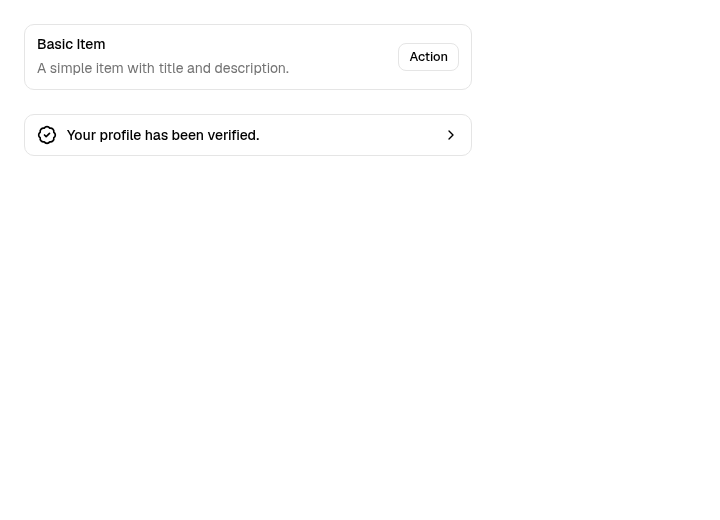
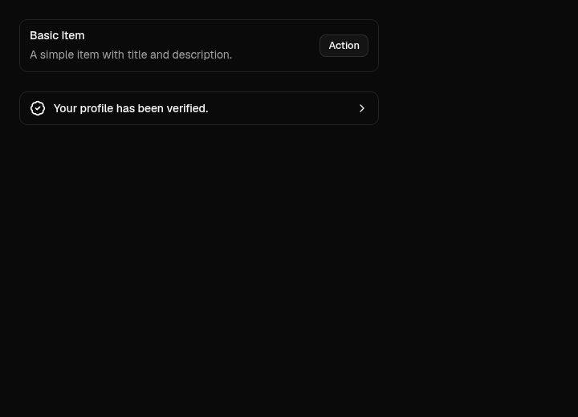

# Item

上游示例样式为 `base-nova`。 [官方示例](https://ui.shadcn.com/examples/base/item-demo) · [示例源码](https://github.com/shadcn-ui/ui/blob/0e5b2e621a9ee4cf6a604bbe6c5c0d5b70561eb4/apps/v4/examples/base/item-demo.tsx) · [采集记录](./provenance.json)

| 状态 | 主题 | 截图 |
| --- | --- | --- |
| 初始态 | 浅色 |  |
| 初始态 | 深色 |  |

## 变体和交互状态

[采集记录](coverage.json)

| 官方示例 | 变体 | 截图状态 | 示例样式 | 参考截图 |
| --- | --- | --- | --- | --- |
| [item-avatar](https://ui.shadcn.com/examples/base/item-avatar) | `avatar` | `initial` | `base-nova` | [浅色](item-avatar-initial-light.png) · [深色](item-avatar-initial-dark.png) |
| [item-dropdown](https://ui.shadcn.com/examples/base/item-dropdown) | `dropdown` | `initial` | `base-nova` | [浅色](item-dropdown-initial-light.png) · [深色](item-dropdown-initial-dark.png) |
| [item-group](https://ui.shadcn.com/examples/base/item-group) | `group` | `initial` | `base-nova` | [浅色](item-group-initial-light.png) · [深色](item-group-initial-dark.png) |
| [item-header](https://ui.shadcn.com/examples/base/item-header) | `header` | `initial` | `base-nova` | [浅色](item-header-initial-light.png) · [深色](item-header-initial-dark.png) |
| [item-icon](https://ui.shadcn.com/examples/base/item-icon) | `icon` | `initial` | `base-nova` | [浅色](item-icon-initial-light.png) · [深色](item-icon-initial-dark.png) |
| [item-image](https://ui.shadcn.com/examples/base/item-image) | `image` | `initial` | `base-nova` | [浅色](item-image-initial-light.png) · [深色](item-image-initial-dark.png) |
| [item-link](https://ui.shadcn.com/examples/base/item-link) | `link` | `initial` | `base-nova` | [浅色](item-link-initial-light.png) · [深色](item-link-initial-dark.png) |
| [item-rtl](https://ui.shadcn.com/examples/base/item-rtl) | `rtl` | `initial` | `example-defined` | [浅色](item-rtl-initial-light.png) · [深色](item-rtl-initial-dark.png) |
| [item-size](https://ui.shadcn.com/examples/base/item-size) | `size` | `initial` | `base-nova` | [浅色](item-size-initial-light.png) · [深色](item-size-initial-dark.png) |
| [item-variant](https://ui.shadcn.com/examples/base/item-variant) | `variant` | `initial` | `base-nova` | [浅色](item-variant-initial-light.png) · [深色](item-variant-initial-dark.png) |
| [muted-item-group](https://ui.shadcn.com/examples/base/muted-item-group) | `muted-item-group` | `initial` | `base-nova` | [浅色](item-muted-item-group-initial-light.png) · [深色](item-muted-item-group-initial-dark.png) |
| [outline-item-group](https://ui.shadcn.com/examples/base/outline-item-group) | `outline-item-group` | `initial` | `base-nova` | [浅色](item-outline-item-group-initial-light.png) · [深色](item-outline-item-group-initial-dark.png) |
