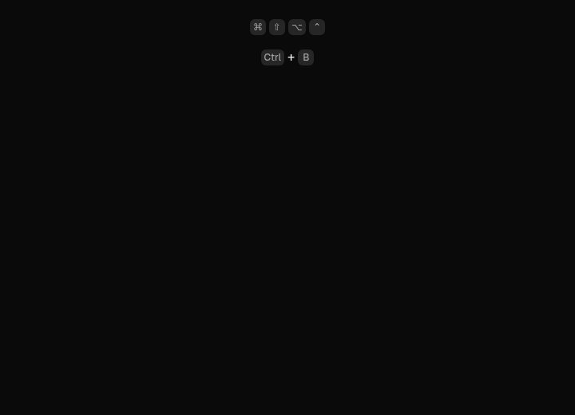

# Kbd

上游示例样式为 `base-nova`。 [官方示例](https://ui.shadcn.com/examples/base/kbd-demo) · [示例源码](https://github.com/shadcn-ui/ui/blob/0e5b2e621a9ee4cf6a604bbe6c5c0d5b70561eb4/apps/v4/examples/base/kbd-demo.tsx) · [采集记录](./provenance.json)

| 序号 | 状态 | 主题 | 截图 |
| ---: | --- | --- | --- |
| 1 | 初始态 | 浅色 |  |
| 2 | 初始态 | 深色 |  |

## 变体和交互状态

[采集记录](coverage.json)

| 序号 | 官方示例 | 变体 | 截图状态 | 示例样式 | 参考截图 |
| ---: | --- | --- | --- | --- | --- |
| 1 | [kbd-button](https://ui.shadcn.com/examples/base/kbd-button) | `button` | `initial` | `base-nova` | [浅色](kbd-button-initial-light.png) · [深色](kbd-button-initial-dark.png) |
| 2 | [kbd-group](https://ui.shadcn.com/examples/base/kbd-group) | `group` | `initial` | `base-nova` | [浅色](kbd-group-initial-light.png) · [深色](kbd-group-initial-dark.png) |
| 3 | [kbd-input-group](https://ui.shadcn.com/examples/base/kbd-input-group) | `input-group` | `initial` | `base-nova` | [浅色](kbd-input-group-initial-light.png) · [深色](kbd-input-group-initial-dark.png) |
| 4 | [kbd-rtl](https://ui.shadcn.com/examples/base/kbd-rtl) | `rtl` | `initial` | `example-defined` | [浅色](kbd-rtl-initial-light.png) · [深色](kbd-rtl-initial-dark.png) |
| 5 | [kbd-tooltip](https://ui.shadcn.com/examples/base/kbd-tooltip) | `tooltip` | `initial` | `base-nova` | [浅色](kbd-tooltip-initial-light.png) · [深色](kbd-tooltip-initial-dark.png) |
