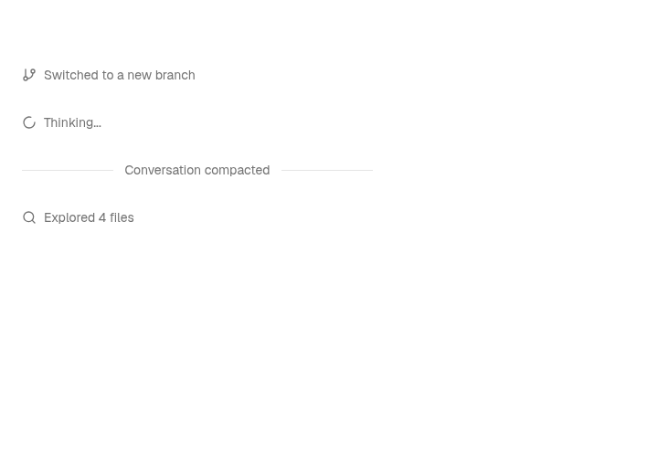
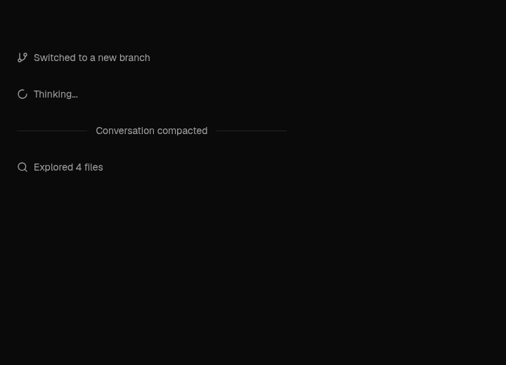

# Marker

上游示例样式为 `base-rhea`。 [官方示例](https://ui.shadcn.com/examples/base/marker-demo) · [示例源码](https://github.com/shadcn-ui/ui/blob/0e5b2e621a9ee4cf6a604bbe6c5c0d5b70561eb4/apps/v4/examples/base/marker-demo.tsx) · [采集记录](./provenance.json)

| 状态 | 主题 | 截图 |
| --- | --- | --- |
| 初始态 | 浅色 |  |
| 初始态 | 深色 |  |

## 变体和交互状态

[采集记录](coverage.json)

| 官方示例 | 变体 | 截图状态 | 示例样式 | 参考截图 |
| --- | --- | --- | --- | --- |
| [marker-border](https://ui.shadcn.com/examples/base/marker-border) | `border` | `initial` | `base-rhea` | [浅色](marker-border-initial-light.png) · [深色](marker-border-initial-dark.png) |
| [marker-icon](https://ui.shadcn.com/examples/base/marker-icon) | `icon` | `initial` | `base-rhea` | [浅色](marker-icon-initial-light.png) · [深色](marker-icon-initial-dark.png) |
| [marker-link-button](https://ui.shadcn.com/examples/base/marker-link-button) | `link-button` | `initial` | `base-rhea` | [浅色](marker-link-button-initial-light.png) · [深色](marker-link-button-initial-dark.png) |
| [marker-separator](https://ui.shadcn.com/examples/base/marker-separator) | `separator` | `initial` | `base-rhea` | [浅色](marker-separator-initial-light.png) · [深色](marker-separator-initial-dark.png) |
| [marker-shimmer](https://ui.shadcn.com/examples/base/marker-shimmer) | `shimmer` | `initial` | `base-rhea` | [浅色](marker-shimmer-initial-light.png) · [深色](marker-shimmer-initial-dark.png) |
| [marker-status](https://ui.shadcn.com/examples/base/marker-status) | `status` | `initial` | `base-rhea` | [浅色](marker-status-initial-light.png) · [深色](marker-status-initial-dark.png) |
| [marker-variants](https://ui.shadcn.com/examples/base/marker-variants) | `variants` | `initial` | `base-rhea` | [浅色](marker-variants-initial-light.png) · [深色](marker-variants-initial-dark.png) |
