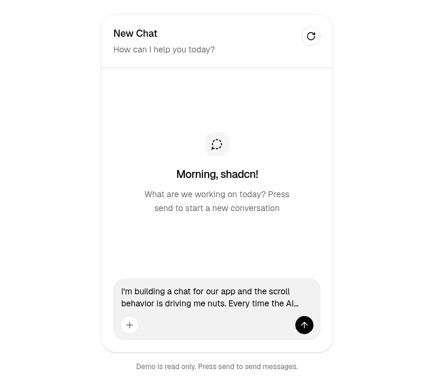
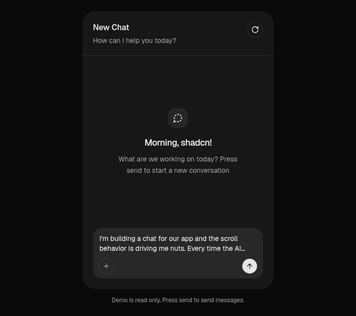

# Message Scroller

上游示例样式为 `base-rhea`。 [官方示例](https://ui.shadcn.com/examples/base/message-scroller-demo) · [示例源码](https://github.com/shadcn-ui/ui/blob/0e5b2e621a9ee4cf6a604bbe6c5c0d5b70561eb4/apps/v4/examples/base/message-scroller-demo.tsx) · [采集记录](./provenance.json)

| 序号 | 状态 | 主题 | 截图 |
| ---: | --- | --- | --- |
| 1 | 初始态 | 浅色 |  |
| 2 | 初始态 | 深色 |  |

## 变体和交互状态

[采集记录](coverage.json)

| 序号 | 官方示例 | 变体 | 截图状态 | 示例样式 | 参考截图 |
| ---: | --- | --- | --- | --- | --- |
| 1 | [message-scroller-anchoring](https://ui.shadcn.com/examples/base/message-scroller-anchoring) | `anchoring` | `initial` | `base-rhea` | [浅色](message-scroller-anchoring-initial-light.png) · [深色](message-scroller-anchoring-initial-dark.png) |
| 2 | [message-scroller-animation](https://ui.shadcn.com/examples/base/message-scroller-animation) | `animation` | `initial` | `base-rhea` | [浅色](message-scroller-animation-initial-light.png) · [深色](message-scroller-animation-initial-dark.png) |
| 3 | [message-scroller-commands](https://ui.shadcn.com/examples/base/message-scroller-commands) | `commands` | `initial` | `base-rhea` | [浅色](message-scroller-commands-initial-light.png) · [深色](message-scroller-commands-initial-dark.png) |
| 4 | [message-scroller-group-chat](https://ui.shadcn.com/examples/base/message-scroller-group-chat) | `group-chat` | `initial` | `base-rhea` | [浅色](message-scroller-group-chat-initial-light.png) · [深色](message-scroller-group-chat-initial-dark.png) |
| 5 | [message-scroller-load-history](https://ui.shadcn.com/examples/base/message-scroller-load-history) | `load-history` | `initial` | `base-rhea` | [浅色](message-scroller-load-history-initial-light.png) · [深色](message-scroller-load-history-initial-dark.png) |
| 6 | [message-scroller-opening-position](https://ui.shadcn.com/examples/base/message-scroller-opening-position) | `opening-position` | `initial` | `base-rhea` | [浅色](message-scroller-opening-position-initial-light.png) · [深色](message-scroller-opening-position-initial-dark.png) |
| 7 | [message-scroller-previous-context](https://ui.shadcn.com/examples/base/message-scroller-previous-context) | `previous-context` | `initial` | `base-rhea` | [浅色](message-scroller-previous-context-initial-light.png) · [深色](message-scroller-previous-context-initial-dark.png) |
| 8 | [message-scroller-scrollable](https://ui.shadcn.com/examples/base/message-scroller-scrollable) | `scrollable` | `initial` | `base-rhea` | [浅色](message-scroller-scrollable-initial-light.png) · [深色](message-scroller-scrollable-initial-dark.png) |
| 9 | [message-scroller-state](https://ui.shadcn.com/examples/base/message-scroller-state) | `state` | `initial` | `base-rhea` | [浅色](message-scroller-state-initial-light.png) · [深色](message-scroller-state-initial-dark.png) |
| 10 | [message-scroller-streaming](https://ui.shadcn.com/examples/base/message-scroller-streaming) | `streaming` | `initial` | `base-rhea` | [浅色](message-scroller-streaming-initial-light.png) · [深色](message-scroller-streaming-initial-dark.png) |
| 11 | [message-scroller-visibility](https://ui.shadcn.com/examples/base/message-scroller-visibility) | `visibility` | `initial` | `base-rhea` | [浅色](message-scroller-visibility-initial-light.png) · [深色](message-scroller-visibility-initial-dark.png) |
