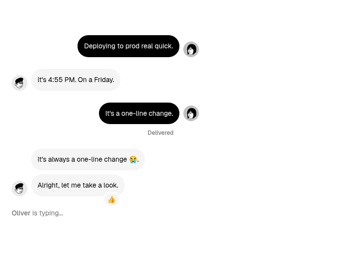
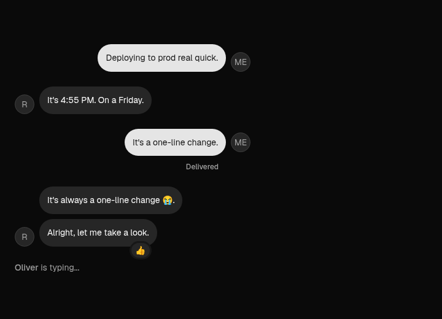

# Message

上游示例样式为 `base-rhea`。 [官方示例](https://ui.shadcn.com/examples/base/message-demo) · [示例源码](https://github.com/shadcn-ui/ui/blob/0e5b2e621a9ee4cf6a604bbe6c5c0d5b70561eb4/apps/v4/examples/base/message-demo.tsx) · [采集记录](./provenance.json)

| 序号 | 状态 | 主题 | 截图 |
| ---: | --- | --- | --- |
| 1 | 初始态 | 浅色 |  |
| 2 | 初始态 | 深色 |  |

## 变体和交互状态

[采集记录](coverage.json)

| 序号 | 官方示例 | 变体 | 截图状态 | 示例样式 | 参考截图 |
| ---: | --- | --- | --- | --- | --- |
| 1 | [message-actions](https://ui.shadcn.com/examples/base/message-actions) | `actions` | `initial` | `base-rhea` | [浅色](message-actions-initial-light.png) · [深色](message-actions-initial-dark.png) |
| 2 | [message-attachment](https://ui.shadcn.com/examples/base/message-attachment) | `attachment` | `initial` | `base-rhea` | [浅色](message-attachment-initial-light.png) · [深色](message-attachment-initial-dark.png) |
| 3 | [message-avatar](https://ui.shadcn.com/examples/base/message-avatar) | `avatar` | `initial` | `base-rhea` | [浅色](message-avatar-initial-light.png) · [深色](message-avatar-initial-dark.png) |
| 4 | [message-group](https://ui.shadcn.com/examples/base/message-group) | `group` | `initial` | `base-rhea` | [浅色](message-group-initial-light.png) · [深色](message-group-initial-dark.png) |
| 5 | [message-header-footer](https://ui.shadcn.com/examples/base/message-header-footer) | `header-footer` | `initial` | `base-rhea` | [浅色](message-header-footer-initial-light.png) · [深色](message-header-footer-initial-dark.png) |
| 6 | [message-markdown](https://ui.shadcn.com/examples/base/message-markdown) | `markdown` | `initial` | `base-rhea` | [浅色](message-markdown-initial-light.png) · [深色](message-markdown-initial-dark.png) |
| 7 | [message-pattern](https://ui.shadcn.com/examples/base/message-pattern) | `pattern` | `initial` | `base-rhea` | [浅色](message-pattern-initial-light.png) · [深色](message-pattern-initial-dark.png) |
| 8 | [message-actions](https://ui.shadcn.com/examples/base/message-actions) | `actions` | `keyboard-focused` | `base-rhea` | [浅色](message-actions-keyboard-focused-light.png) · [深色](message-actions-keyboard-focused-dark.png) |
