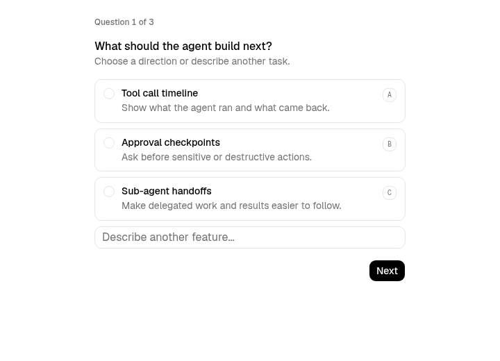
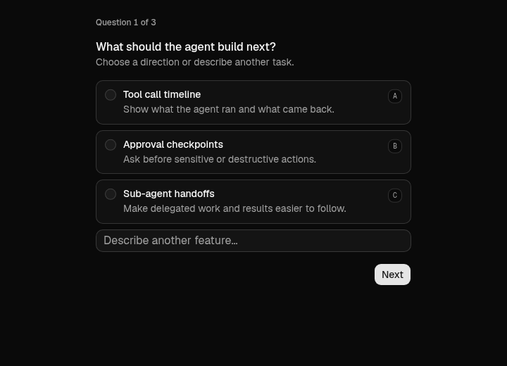

# Questionnaire

上游示例样式为 `base-nova`。 [官方示例](https://ui.shadcn.com/examples/base/questionnaire-demo) · [示例源码](https://github.com/shadcn-ui/ui/blob/0e5b2e621a9ee4cf6a604bbe6c5c0d5b70561eb4/apps/v4/examples/base/questionnaire-demo.tsx) · [采集记录](./provenance.json)

| 序号 | 状态 | 主题 | 截图 |
| ---: | --- | --- | --- |
| 1 | 初始态 | 浅色 |  |
| 2 | 初始态 | 深色 |  |

## 变体和交互状态

[采集记录](coverage.json)

| 序号 | 官方示例 | 变体 | 截图状态 | 示例样式 | 参考截图 |
| ---: | --- | --- | --- | --- | --- |
| 1 | [questionnaire-animated](https://ui.shadcn.com/examples/base/questionnaire-animated) | `animated` | `initial` | `base-nova` | [浅色](questionnaire-animated-initial-light.png) · [深色](questionnaire-animated-initial-dark.png) |
| 2 | [questionnaire-card](https://ui.shadcn.com/examples/base/questionnaire-card) | `card` | `initial` | `base-nova` | [浅色](questionnaire-card-initial-light.png) · [深色](questionnaire-card-initial-dark.png) |
| 3 | [questionnaire-conditional](https://ui.shadcn.com/examples/base/questionnaire-conditional) | `conditional` | `initial` | `base-nova` | [浅色](questionnaire-conditional-initial-light.png) · [深色](questionnaire-conditional-initial-dark.png) |
| 4 | [questionnaire-controlled](https://ui.shadcn.com/examples/base/questionnaire-controlled) | `controlled` | `initial` | `base-nova` | [浅色](questionnaire-controlled-initial-light.png) · [深色](questionnaire-controlled-initial-dark.png) |
| 5 | [questionnaire-dialog](https://ui.shadcn.com/examples/base/questionnaire-dialog) | `dialog` | `initial` | `base-nova` | [浅色](questionnaire-dialog-initial-light.png) · [深色](questionnaire-dialog-initial-dark.png) |
| 6 | [questionnaire-freeform](https://ui.shadcn.com/examples/base/questionnaire-freeform) | `freeform` | `initial` | `base-nova` | [浅色](questionnaire-freeform-initial-light.png) · [深色](questionnaire-freeform-initial-dark.png) |
| 7 | [questionnaire-multiple](https://ui.shadcn.com/examples/base/questionnaire-multiple) | `multiple` | `initial` | `base-nova` | [浅色](questionnaire-multiple-initial-light.png) · [深色](questionnaire-multiple-initial-dark.png) |
| 8 | [questionnaire-navigation-state](https://ui.shadcn.com/examples/base/questionnaire-navigation-state) | `navigation-state` | `initial` | `base-nova` | [浅色](questionnaire-navigation-state-initial-light.png) · [深色](questionnaire-navigation-state-initial-dark.png) |
| 9 | [questionnaire-progress](https://ui.shadcn.com/examples/base/questionnaire-progress) | `progress` | `initial` | `base-nova` | [浅色](questionnaire-progress-initial-light.png) · [深色](questionnaire-progress-initial-dark.png) |
| 10 | [questionnaire-resume](https://ui.shadcn.com/examples/base/questionnaire-resume) | `resume` | `initial` | `base-nova` | [浅色](questionnaire-resume-initial-light.png) · [深色](questionnaire-resume-initial-dark.png) |
| 11 | [questionnaire-shortcuts](https://ui.shadcn.com/examples/base/questionnaire-shortcuts) | `shortcuts` | `initial` | `base-nova` | [浅色](questionnaire-shortcuts-initial-light.png) · [深色](questionnaire-shortcuts-initial-dark.png) |
| 12 | [questionnaire-skip](https://ui.shadcn.com/examples/base/questionnaire-skip) | `skip` | `initial` | `base-nova` | [浅色](questionnaire-skip-initial-light.png) · [深色](questionnaire-skip-initial-dark.png) |
| 13 | [questionnaire-validation](https://ui.shadcn.com/examples/base/questionnaire-validation) | `validation` | `initial` | `base-nova` | [浅色](questionnaire-validation-initial-light.png) · [深色](questionnaire-validation-initial-dark.png) |
| 14 | [questionnaire-demo](https://ui.shadcn.com/examples/base/questionnaire-demo) | `default` | `keyboard-focused` | `base-nova` | [浅色](questionnaire-default-keyboard-focused-light.png) · [深色](questionnaire-default-keyboard-focused-dark.png) |
