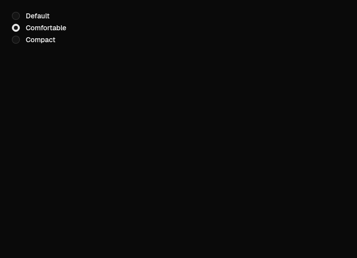

# Radio Group

上游示例样式为 `base-nova`。 [官方示例](https://ui.shadcn.com/examples/base/radio-group-demo) · [示例源码](https://github.com/shadcn-ui/ui/blob/0e5b2e621a9ee4cf6a604bbe6c5c0d5b70561eb4/apps/v4/examples/base/radio-group-demo.tsx) · [采集记录](./provenance.json)

| 状态 | 主题 | 截图 |
| --- | --- | --- |
| 初始态 | 浅色 |  |
| 初始态 | 深色 |  |

## 变体和交互状态

[采集记录](coverage.json)

| 官方示例 | 变体 | 截图状态 | 示例样式 | 参考截图 |
| --- | --- | --- | --- | --- |
| [radio-fields](https://ui.shadcn.com/examples/base/radio-fields) | `radio-fields` | `initial` | `base-nova` | [浅色](radio-group-radio-fields-initial-light.png) · [深色](radio-group-radio-fields-initial-dark.png) |
| [radio-group-choice-card](https://ui.shadcn.com/examples/base/radio-group-choice-card) | `choice-card` | `initial` | `base-nova` | [浅色](radio-group-choice-card-initial-light.png) · [深色](radio-group-choice-card-initial-dark.png) |
| [radio-group-demo](https://ui.shadcn.com/examples/base/radio-group-demo) | `default` | `compact` | `base-nova` | [浅色](radio-group-default-compact-light.png) · [深色](radio-group-default-compact-dark.png) |
| [radio-group-description](https://ui.shadcn.com/examples/base/radio-group-description) | `description` | `initial` | `base-nova` | [浅色](radio-group-description-initial-light.png) · [深色](radio-group-description-initial-dark.png) |
| [radio-group-disabled](https://ui.shadcn.com/examples/base/radio-group-disabled) | `disabled` | `initial` | `base-nova` | [浅色](radio-group-disabled-initial-light.png) · [深色](radio-group-disabled-initial-dark.png) |
| [radio-group-fieldset](https://ui.shadcn.com/examples/base/radio-group-fieldset) | `fieldset` | `initial` | `base-nova` | [浅色](radio-group-fieldset-initial-light.png) · [深色](radio-group-fieldset-initial-dark.png) |
| [radio-group-invalid](https://ui.shadcn.com/examples/base/radio-group-invalid) | `invalid` | `initial` | `base-nova` | [浅色](radio-group-invalid-initial-light.png) · [深色](radio-group-invalid-initial-dark.png) |
| [radio-group-rtl](https://ui.shadcn.com/examples/base/radio-group-rtl) | `rtl` | `initial` | `example-defined` | [浅色](radio-group-rtl-initial-light.png) · [深色](radio-group-rtl-initial-dark.png) |
