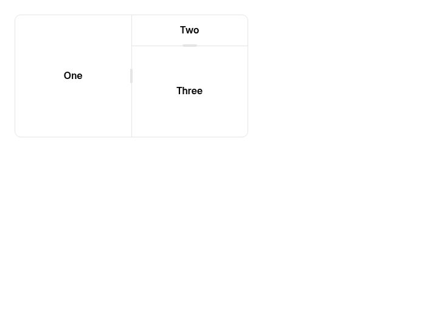
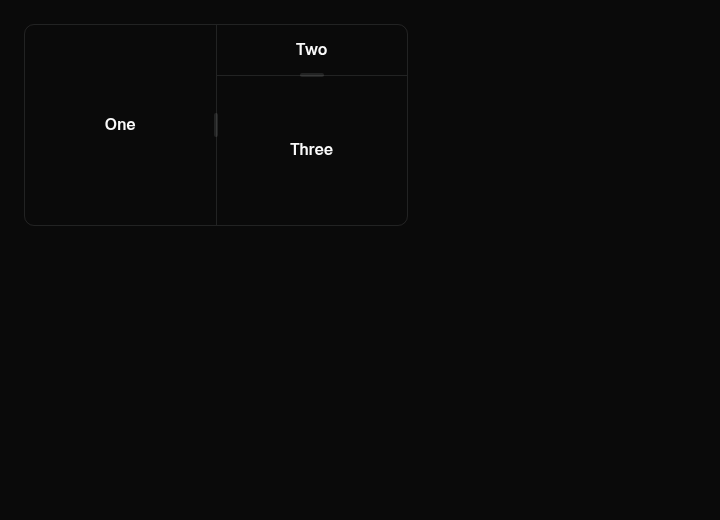

# Resizable

上游示例样式为 `base-nova`。 [官方示例](https://ui.shadcn.com/examples/base/resizable-demo) · [示例源码](https://github.com/shadcn-ui/ui/blob/0e5b2e621a9ee4cf6a604bbe6c5c0d5b70561eb4/apps/v4/examples/base/resizable-demo.tsx) · [采集记录](./provenance.json)

| 序号 | 状态 | 主题 | 截图 |
| ---: | --- | --- | --- |
| 1 | 初始态 | 浅色 |  |
| 2 | 初始态 | 深色 |  |

## 变体和交互状态

[采集记录](coverage.json)

| 序号 | 官方示例 | 变体 | 截图状态 | 示例样式 | 参考截图 |
| ---: | --- | --- | --- | --- | --- |
| 1 | [resizable-handle](https://ui.shadcn.com/examples/base/resizable-handle) | `handle` | `initial` | `base-nova` | [浅色](resizable-handle-initial-light.png) · [深色](resizable-handle-initial-dark.png) |
| 2 | [resizable-rtl](https://ui.shadcn.com/examples/base/resizable-rtl) | `rtl` | `initial` | `example-defined` | [浅色](resizable-rtl-initial-light.png) · [深色](resizable-rtl-initial-dark.png) |
| 3 | [resizable-vertical](https://ui.shadcn.com/examples/base/resizable-vertical) | `vertical` | `initial` | `base-nova` | [浅色](resizable-vertical-initial-light.png) · [深色](resizable-vertical-initial-dark.png) |
