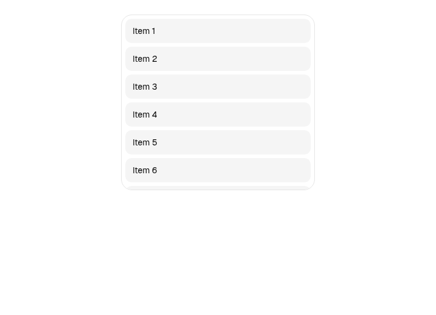
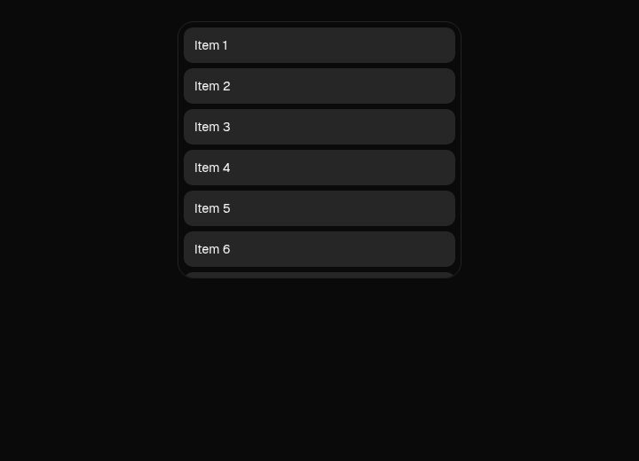

# Scroll Fade

上游示例样式为 `example-defined`。 [官方示例](https://ui.shadcn.com/examples/base/scroll-fade-demo) · [示例源码](https://github.com/shadcn-ui/ui/blob/0e5b2e621a9ee4cf6a604bbe6c5c0d5b70561eb4/apps/v4/examples/base/scroll-fade-demo.tsx) · [采集记录](./provenance.json)

| 状态 | 主题 | 截图 |
| --- | --- | --- |
| 初始态 | 浅色 |  |
| 初始态 | 深色 |  |

## 变体和交互状态

[采集记录](coverage.json)

| 官方示例 | 变体 | 截图状态 | 示例样式 | 参考截图 |
| --- | --- | --- | --- | --- |
| [scroll-fade-edge](https://ui.shadcn.com/examples/base/scroll-fade-edge) | `edge` | `initial` | `example-defined` | [浅色](scroll-fade-edge-initial-light.png) · [深色](scroll-fade-edge-initial-dark.png) |
| [scroll-fade-horizontal](https://ui.shadcn.com/examples/base/scroll-fade-horizontal) | `horizontal` | `initial` | `example-defined` | [浅色](scroll-fade-horizontal-initial-light.png) · [深色](scroll-fade-horizontal-initial-dark.png) |
| [scroll-fade-none](https://ui.shadcn.com/examples/base/scroll-fade-none) | `none` | `initial` | `example-defined` | [浅色](scroll-fade-none-initial-light.png) · [深色](scroll-fade-none-initial-dark.png) |
| [scroll-fade-overflow](https://ui.shadcn.com/examples/base/scroll-fade-overflow) | `overflow` | `initial` | `example-defined` | [浅色](scroll-fade-overflow-initial-light.png) · [深色](scroll-fade-overflow-initial-dark.png) |
| [scroll-fade-rtl](https://ui.shadcn.com/examples/base/scroll-fade-rtl) | `rtl` | `initial` | `example-defined` | [浅色](scroll-fade-rtl-initial-light.png) · [深色](scroll-fade-rtl-initial-dark.png) |
| [scroll-fade-size](https://ui.shadcn.com/examples/base/scroll-fade-size) | `size` | `initial` | `example-defined` | [浅色](scroll-fade-size-initial-light.png) · [深色](scroll-fade-size-initial-dark.png) |
