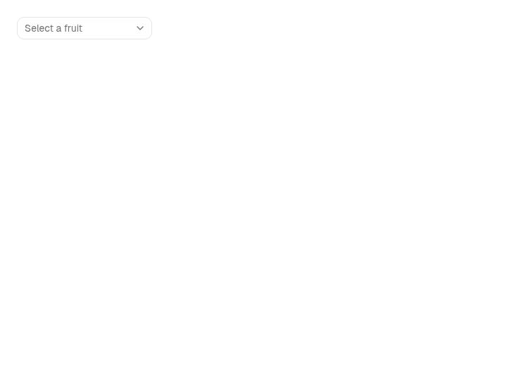
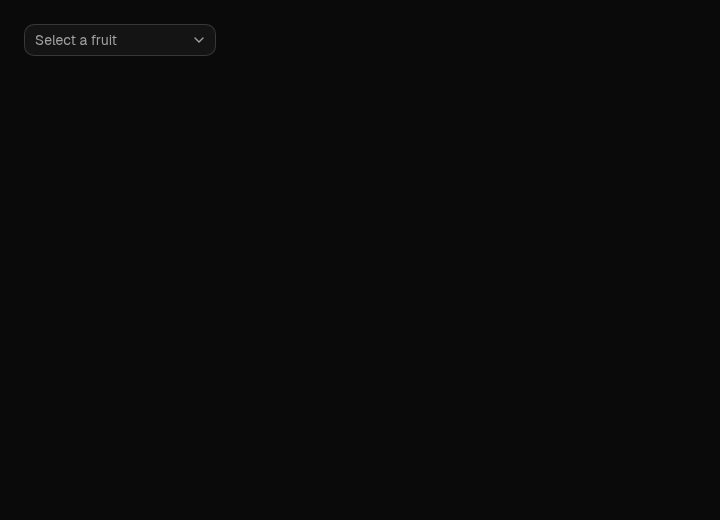

# Select

上游示例样式为 `base-nova`。 [官方示例](https://ui.shadcn.com/examples/base/select-demo) · [示例源码](https://github.com/shadcn-ui/ui/blob/0e5b2e621a9ee4cf6a604bbe6c5c0d5b70561eb4/apps/v4/examples/base/select-demo.tsx) · [采集记录](./provenance.json)

| 序号 | 状态 | 主题 | 截图 |
| ---: | --- | --- | --- |
| 1 | 初始态 | 浅色 |  |
| 2 | 初始态 | 深色 |  |

## 变体和交互状态

[采集记录](coverage.json)

| 序号 | 官方示例 | 变体 | 截图状态 | 示例样式 | 参考截图 |
| ---: | --- | --- | --- | --- | --- |
| 1 | [select-align-item](https://ui.shadcn.com/examples/base/select-align-item) | `align-item` | `initial` | `base-nova` | [浅色](select-align-item-initial-light.png) · [深色](select-align-item-initial-dark.png) |
| 2 | [select-disabled](https://ui.shadcn.com/examples/base/select-disabled) | `disabled` | `initial` | `base-nova` | [浅色](select-disabled-initial-light.png) · [深色](select-disabled-initial-dark.png) |
| 3 | [select-groups](https://ui.shadcn.com/examples/base/select-groups) | `groups` | `initial` | `base-nova` | [浅色](select-groups-initial-light.png) · [深色](select-groups-initial-dark.png) |
| 4 | [select-groups](https://ui.shadcn.com/examples/base/select-groups) | `groups` | `open` | `base-nova` | [浅色](select-groups-open-light.png) · [深色](select-groups-open-dark.png) |
| 5 | [select-invalid](https://ui.shadcn.com/examples/base/select-invalid) | `invalid` | `initial` | `base-nova` | [浅色](select-invalid-initial-light.png) · [深色](select-invalid-initial-dark.png) |
| 6 | [select-invalid](https://ui.shadcn.com/examples/base/select-invalid) | `invalid` | `open` | `base-nova` | [浅色](select-invalid-open-light.png) · [深色](select-invalid-open-dark.png) |
| 7 | [select-demo](https://ui.shadcn.com/examples/base/select-demo) | `default` | `open` | `base-nova` | [浅色](select-default-open-light.png) · [深色](select-default-open-dark.png) |
| 8 | [select-rtl](https://ui.shadcn.com/examples/base/select-rtl) | `rtl` | `initial` | `example-defined` | [浅色](select-rtl-initial-light.png) · [深色](select-rtl-initial-dark.png) |
| 9 | [select-rtl](https://ui.shadcn.com/examples/base/select-rtl) | `rtl` | `open` | `example-defined` | [浅色](select-rtl-open-light.png) · [深色](select-rtl-open-dark.png) |
| 10 | [select-scrollable](https://ui.shadcn.com/examples/base/select-scrollable) | `scrollable` | `initial` | `base-nova` | [浅色](select-scrollable-initial-light.png) · [深色](select-scrollable-initial-dark.png) |
| 11 | [select-scrollable](https://ui.shadcn.com/examples/base/select-scrollable) | `scrollable` | `open` | `base-nova` | [浅色](select-scrollable-open-light.png) · [深色](select-scrollable-open-dark.png) |
