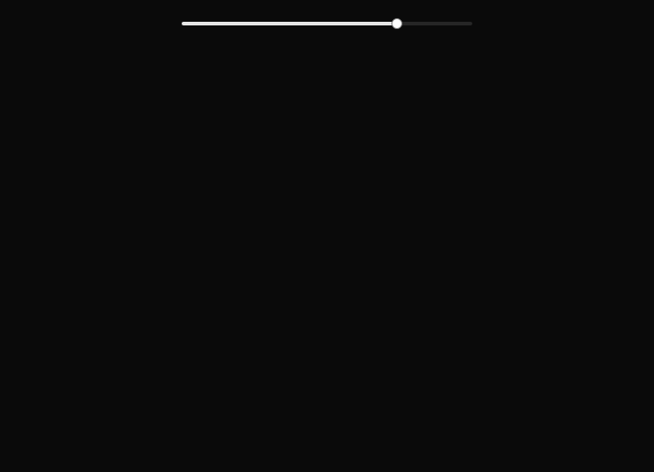

# Slider

上游示例样式为 `base-nova`。 [官方示例](https://ui.shadcn.com/examples/base/slider-demo) · [示例源码](https://github.com/shadcn-ui/ui/blob/0e5b2e621a9ee4cf6a604bbe6c5c0d5b70561eb4/apps/v4/examples/base/slider-demo.tsx) · [采集记录](./provenance.json)

| 状态 | 主题 | 截图 |
| --- | --- | --- |
| 初始态 | 浅色 |  |
| 初始态 | 深色 |  |

## 变体和交互状态

[采集记录](coverage.json)

| 官方示例 | 变体 | 截图状态 | 示例样式 | 参考截图 |
| --- | --- | --- | --- | --- |
| [slider-controlled](https://ui.shadcn.com/examples/base/slider-controlled) | `controlled` | `initial` | `base-nova` | [浅色](slider-controlled-initial-light.png) · [深色](slider-controlled-initial-dark.png) |
| [slider-demo](https://ui.shadcn.com/examples/base/slider-demo) | `default` | `increased` | `base-nova` | [浅色](slider-default-increased-light.png) · [深色](slider-default-increased-dark.png) |
| [slider-disabled](https://ui.shadcn.com/examples/base/slider-disabled) | `disabled` | `initial` | `base-nova` | [浅色](slider-disabled-initial-light.png) · [深色](slider-disabled-initial-dark.png) |
| [slider-multiple](https://ui.shadcn.com/examples/base/slider-multiple) | `multiple` | `initial` | `base-nova` | [浅色](slider-multiple-initial-light.png) · [深色](slider-multiple-initial-dark.png) |
| [slider-range](https://ui.shadcn.com/examples/base/slider-range) | `range` | `initial` | `base-nova` | [浅色](slider-range-initial-light.png) · [深色](slider-range-initial-dark.png) |
| [slider-rtl](https://ui.shadcn.com/examples/base/slider-rtl) | `rtl` | `initial` | `example-defined` | [浅色](slider-rtl-initial-light.png) · [深色](slider-rtl-initial-dark.png) |
| [slider-vertical](https://ui.shadcn.com/examples/base/slider-vertical) | `vertical` | `initial` | `base-nova` | [浅色](slider-vertical-initial-light.png) · [深色](slider-vertical-initial-dark.png) |
