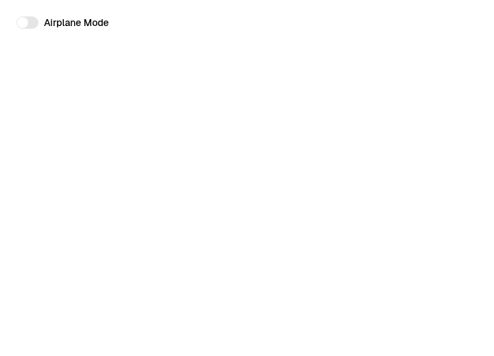
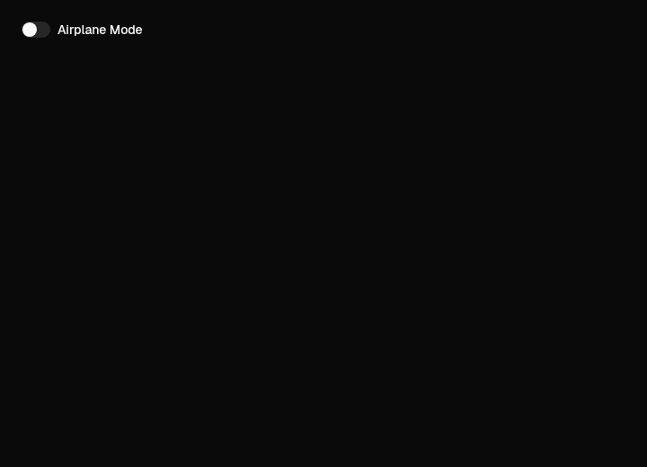

# Switch

上游示例样式为 `base-nova`。 [官方示例](https://ui.shadcn.com/examples/base/switch-demo) · [示例源码](https://github.com/shadcn-ui/ui/blob/0e5b2e621a9ee4cf6a604bbe6c5c0d5b70561eb4/apps/v4/examples/base/switch-demo.tsx) · [采集记录](./provenance.json)

| 序号 | 状态 | 主题 | 截图 |
| ---: | --- | --- | --- |
| 1 | 初始态 | 浅色 |  |
| 2 | 初始态 | 深色 |  |

## 变体和交互状态

[采集记录](coverage.json)

| 序号 | 官方示例 | 变体 | 截图状态 | 示例样式 | 参考截图 |
| ---: | --- | --- | --- | --- | --- |
| 1 | [switch-choice-card](https://ui.shadcn.com/examples/base/switch-choice-card) | `choice-card` | `initial` | `base-nova` | [浅色](switch-choice-card-initial-light.png) · [深色](switch-choice-card-initial-dark.png) |
| 2 | [switch-demo](https://ui.shadcn.com/examples/base/switch-demo) | `default` | `on` | `base-nova` | [浅色](switch-default-on-light.png) · [深色](switch-default-on-dark.png) |
| 3 | [switch-description](https://ui.shadcn.com/examples/base/switch-description) | `description` | `initial` | `base-nova` | [浅色](switch-description-initial-light.png) · [深色](switch-description-initial-dark.png) |
| 4 | [switch-disabled](https://ui.shadcn.com/examples/base/switch-disabled) | `disabled` | `initial` | `base-nova` | [浅色](switch-disabled-initial-light.png) · [深色](switch-disabled-initial-dark.png) |
| 5 | [switch-invalid](https://ui.shadcn.com/examples/base/switch-invalid) | `invalid` | `initial` | `base-nova` | [浅色](switch-invalid-initial-light.png) · [深色](switch-invalid-initial-dark.png) |
| 6 | [switch-rtl](https://ui.shadcn.com/examples/base/switch-rtl) | `rtl` | `initial` | `example-defined` | [浅色](switch-rtl-initial-light.png) · [深色](switch-rtl-initial-dark.png) |
| 7 | [switch-sizes](https://ui.shadcn.com/examples/base/switch-sizes) | `sizes` | `initial` | `base-nova` | [浅色](switch-sizes-initial-light.png) · [深色](switch-sizes-initial-dark.png) |
