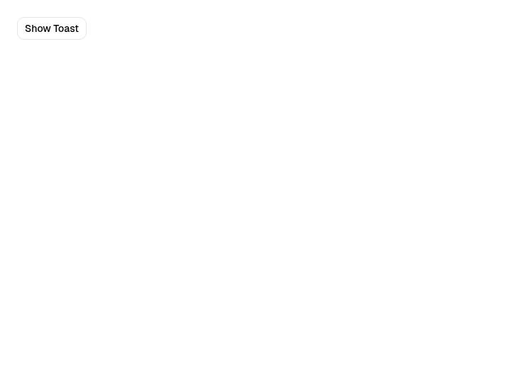
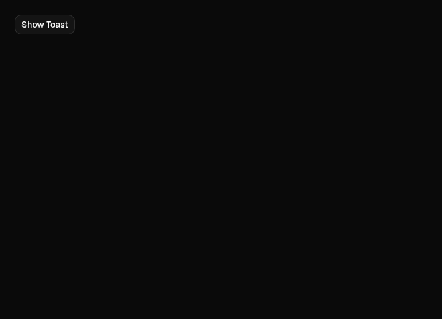

# Toast

上游示例样式为 `base-nova`。 [官方示例](https://ui.shadcn.com/examples/base/toast-demo) · [示例源码](https://github.com/shadcn-ui/ui/blob/0e5b2e621a9ee4cf6a604bbe6c5c0d5b70561eb4/apps/v4/examples/base/toast-demo.tsx) · [采集记录](./provenance.json)

| 序号 | 状态 | 主题 | 截图 |
| ---: | --- | --- | --- |
| 1 | 初始态 | 浅色 |  |
| 2 | 初始态 | 深色 |  |

## 变体和交互状态

[采集记录](coverage.json)

| 序号 | 官方示例 | 变体 | 截图状态 | 示例样式 | 参考截图 |
| ---: | --- | --- | --- | --- | --- |
| 1 | [toast-promise](https://ui.shadcn.com/examples/base/toast-promise) | `promise` | `initial` | `base-nova` | [浅色](toast-promise-initial-light.png) · [深色](toast-promise-initial-dark.png) |
| 2 | [toast-types](https://ui.shadcn.com/examples/base/toast-types) | `types` | `initial` | `base-nova` | [浅色](toast-types-initial-light.png) · [深色](toast-types-initial-dark.png) |
| 3 | [toast-types](https://ui.shadcn.com/examples/base/toast-types) | `types` | `error` | `base-nova` | [浅色](toast-types-error-light.png) · [深色](toast-types-error-dark.png) |
| 4 | [toast-types](https://ui.shadcn.com/examples/base/toast-types) | `types` | `success` | `base-nova` | [浅色](toast-types-success-light.png) · [深色](toast-types-success-dark.png) |
| 5 | [toast-demo](https://ui.shadcn.com/examples/base/toast-demo) | `default` | `visible` | `base-nova` | [浅色](toast-default-visible-light.png) · [深色](toast-default-visible-dark.png) |
| 6 | [toast-demo](https://ui.shadcn.com/examples/base/toast-demo) | `default` | `keyboard-focused` | `base-nova` | [浅色](toast-default-keyboard-focused-light.png) · [深色](toast-default-keyboard-focused-dark.png) |
