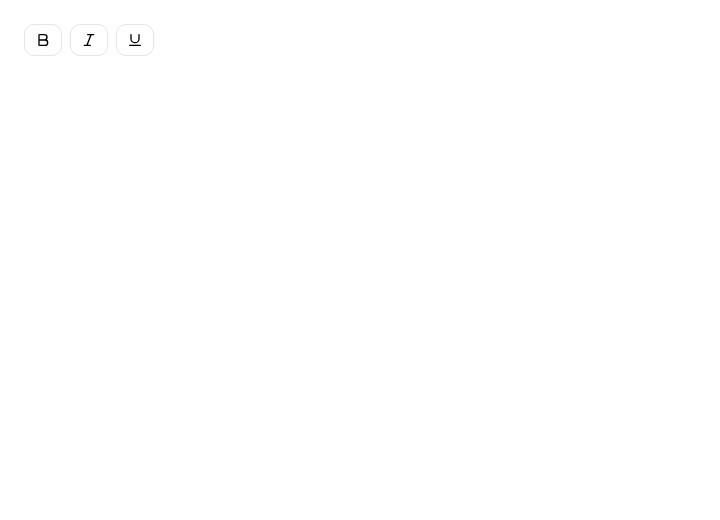
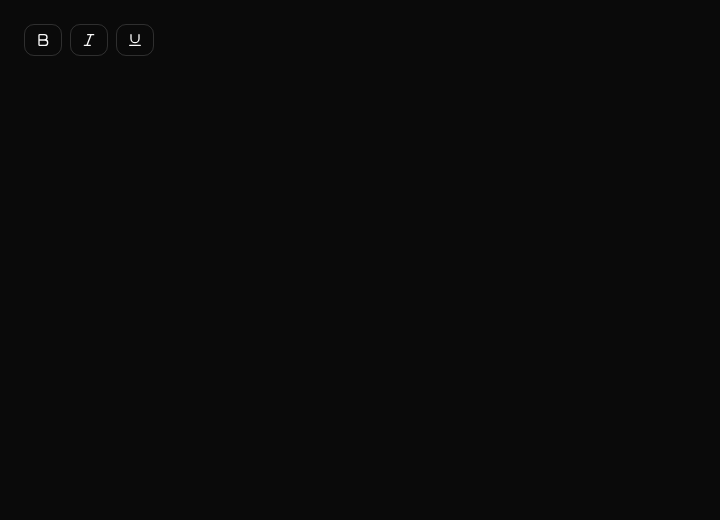

# Toggle Group

上游示例样式为 `base-nova`。 [官方示例](https://ui.shadcn.com/examples/base/toggle-group-demo) · [示例源码](https://github.com/shadcn-ui/ui/blob/0e5b2e621a9ee4cf6a604bbe6c5c0d5b70561eb4/apps/v4/examples/base/toggle-group-demo.tsx) · [采集记录](./provenance.json)

| 状态 | 主题 | 截图 |
| --- | --- | --- |
| 初始态 | 浅色 |  |
| 初始态 | 深色 |  |

## 变体和交互状态

[采集记录](coverage.json)

| 官方示例 | 变体 | 截图状态 | 示例样式 | 参考截图 |
| --- | --- | --- | --- | --- |
| [toggle-group-demo](https://ui.shadcn.com/examples/base/toggle-group-demo) | `default` | `bold` | `base-nova` | [浅色](toggle-group-default-bold-light.png) · [深色](toggle-group-default-bold-dark.png) |
| [toggle-group-disabled](https://ui.shadcn.com/examples/base/toggle-group-disabled) | `disabled` | `initial` | `base-nova` | [浅色](toggle-group-disabled-initial-light.png) · [深色](toggle-group-disabled-initial-dark.png) |
| [toggle-group-font-weight-selector](https://ui.shadcn.com/examples/base/toggle-group-font-weight-selector) | `font-weight-selector` | `initial` | `base-nova` | [浅色](toggle-group-font-weight-selector-initial-light.png) · [深色](toggle-group-font-weight-selector-initial-dark.png) |
| [toggle-group-outline](https://ui.shadcn.com/examples/base/toggle-group-outline) | `outline` | `initial` | `base-nova` | [浅色](toggle-group-outline-initial-light.png) · [深色](toggle-group-outline-initial-dark.png) |
| [toggle-group-rtl](https://ui.shadcn.com/examples/base/toggle-group-rtl) | `rtl` | `initial` | `example-defined` | [浅色](toggle-group-rtl-initial-light.png) · [深色](toggle-group-rtl-initial-dark.png) |
| [toggle-group-sizes](https://ui.shadcn.com/examples/base/toggle-group-sizes) | `sizes` | `initial` | `base-nova` | [浅色](toggle-group-sizes-initial-light.png) · [深色](toggle-group-sizes-initial-dark.png) |
| [toggle-group-spacing](https://ui.shadcn.com/examples/base/toggle-group-spacing) | `spacing` | `initial` | `base-nova` | [浅色](toggle-group-spacing-initial-light.png) · [深色](toggle-group-spacing-initial-dark.png) |
| [toggle-group-vertical](https://ui.shadcn.com/examples/base/toggle-group-vertical) | `vertical` | `initial` | `base-nova` | [浅色](toggle-group-vertical-initial-light.png) · [深色](toggle-group-vertical-initial-dark.png) |
