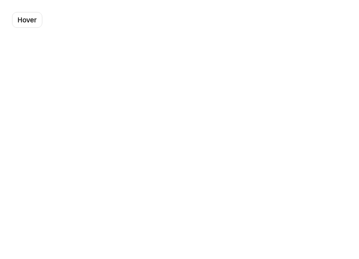
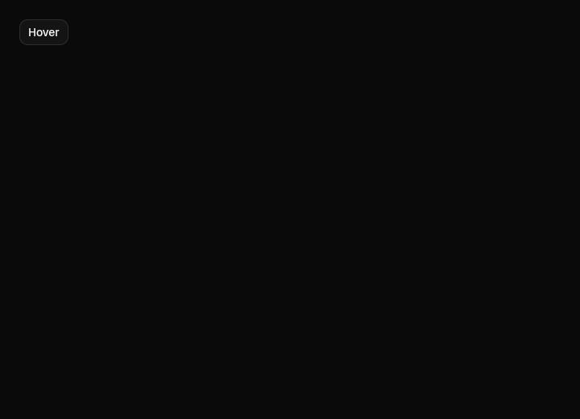

# Tooltip

上游示例样式为 `base-nova`。 [官方示例](https://ui.shadcn.com/examples/base/tooltip-demo) · [示例源码](https://github.com/shadcn-ui/ui/blob/0e5b2e621a9ee4cf6a604bbe6c5c0d5b70561eb4/apps/v4/examples/base/tooltip-demo.tsx) · [采集记录](./provenance.json)

| 状态 | 主题 | 截图 |
| --- | --- | --- |
| 初始态 | 浅色 |  |
| 初始态 | 深色 |  |

## 变体和交互状态

[采集记录](coverage.json)

| 官方示例 | 变体 | 截图状态 | 示例样式 | 参考截图 |
| --- | --- | --- | --- | --- |
| [tooltip-disabled](https://ui.shadcn.com/examples/base/tooltip-disabled) | `disabled` | `initial` | `base-nova` | [浅色](tooltip-disabled-initial-light.png) · [深色](tooltip-disabled-initial-dark.png) |
| [tooltip-keyboard](https://ui.shadcn.com/examples/base/tooltip-keyboard) | `keyboard` | `initial` | `base-nova` | [浅色](tooltip-keyboard-initial-light.png) · [深色](tooltip-keyboard-initial-dark.png) |
| [tooltip-demo](https://ui.shadcn.com/examples/base/tooltip-demo) | `default` | `open` | `base-nova` | [浅色](tooltip-default-open-light.png) · [深色](tooltip-default-open-dark.png) |
| [tooltip-rtl](https://ui.shadcn.com/examples/base/tooltip-rtl) | `rtl` | `initial` | `example-defined` | [浅色](tooltip-rtl-initial-light.png) · [深色](tooltip-rtl-initial-dark.png) |
| [tooltip-sides](https://ui.shadcn.com/examples/base/tooltip-sides) | `sides` | `initial` | `base-nova` | [浅色](tooltip-sides-initial-light.png) · [深色](tooltip-sides-initial-dark.png) |
