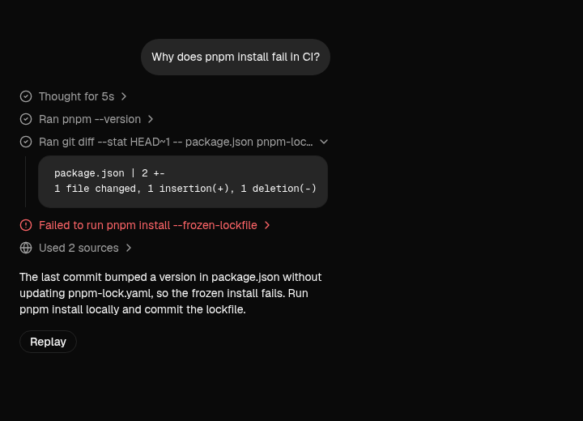

# Trace

上游示例样式为 `base-rhea`。 [官方示例](https://ui.shadcn.com/examples/base/trace-demo) · [示例源码](https://github.com/shadcn-ui/ui/blob/0e5b2e621a9ee4cf6a604bbe6c5c0d5b70561eb4/apps/v4/examples/base/trace-demo.tsx) · [采集记录](./provenance.json)

| 状态 | 主题 | 截图 |
| --- | --- | --- |
| 初始态 | 浅色 |  |
| 初始态 | 深色 |  |

## 变体和交互状态

[采集记录](coverage.json)

| 官方示例 | 变体 | 截图状态 | 示例样式 | 参考截图 |
| --- | --- | --- | --- | --- |
| [trace-collapsible](https://ui.shadcn.com/examples/base/trace-collapsible) | `collapsible` | `initial` | `base-rhea` | [浅色](trace-collapsible-initial-light.png) · [深色](trace-collapsible-initial-dark.png) |
| [trace-commit](https://ui.shadcn.com/examples/base/trace-commit) | `commit` | `initial` | `base-rhea` | [浅色](trace-commit-initial-light.png) · [深色](trace-commit-initial-dark.png) |
| [trace-description](https://ui.shadcn.com/examples/base/trace-description) | `description` | `initial` | `base-rhea` | [浅色](trace-description-initial-light.png) · [深色](trace-description-initial-dark.png) |
| [trace-dialog](https://ui.shadcn.com/examples/base/trace-dialog) | `dialog` | `initial` | `base-rhea` | [浅色](trace-dialog-initial-light.png) · [深色](trace-dialog-initial-dark.png) |
| [trace-group](https://ui.shadcn.com/examples/base/trace-group) | `group` | `initial` | `base-rhea` | [浅色](trace-group-initial-light.png) · [深色](trace-group-initial-dark.png) |
| [trace-link](https://ui.shadcn.com/examples/base/trace-link) | `link` | `initial` | `base-rhea` | [浅色](trace-link-initial-light.png) · [深色](trace-link-initial-dark.png) |
| [trace-open](https://ui.shadcn.com/examples/base/trace-open) | `open` | `initial` | `base-rhea` | [浅色](trace-open-initial-light.png) · [深色](trace-open-initial-dark.png) |
| [trace-sheet](https://ui.shadcn.com/examples/base/trace-sheet) | `sheet` | `initial` | `base-rhea` | [浅色](trace-sheet-initial-light.png) · [深色](trace-sheet-initial-dark.png) |
| [trace-sources](https://ui.shadcn.com/examples/base/trace-sources) | `sources` | `initial` | `base-rhea` | [浅色](trace-sources-initial-light.png) · [深色](trace-sources-initial-dark.png) |
| [trace-static](https://ui.shadcn.com/examples/base/trace-static) | `static` | `initial` | `base-rhea` | [浅色](trace-static-initial-light.png) · [深色](trace-static-initial-dark.png) |
| [trace-status](https://ui.shadcn.com/examples/base/trace-status) | `status` | `initial` | `base-rhea` | [浅色](trace-status-initial-light.png) · [深色](trace-status-initial-dark.png) |
| [trace-steps](https://ui.shadcn.com/examples/base/trace-steps) | `steps` | `initial` | `base-rhea` | [浅色](trace-steps-initial-light.png) · [深色](trace-steps-initial-dark.png) |
| [trace-thinking](https://ui.shadcn.com/examples/base/trace-thinking) | `thinking` | `initial` | `base-rhea` | [浅色](trace-thinking-initial-light.png) · [深色](trace-thinking-initial-dark.png) |
| [trace-tool-calls](https://ui.shadcn.com/examples/base/trace-tool-calls) | `tool-calls` | `initial` | `base-rhea` | [浅色](trace-tool-calls-initial-light.png) · [深色](trace-tool-calls-initial-dark.png) |
| [trace-turn](https://ui.shadcn.com/examples/base/trace-turn) | `turn` | `initial` | `base-rhea` | [浅色](trace-turn-initial-light.png) · [深色](trace-turn-initial-dark.png) |
